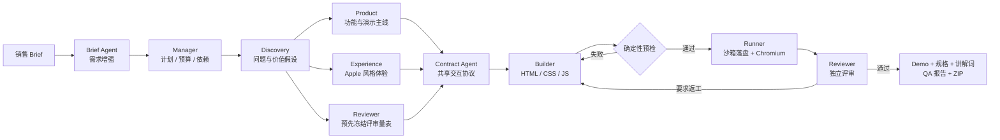

<div align="center">

# DemoPilot

### 业务验收驱动的 Agent Demo 构建与可靠发布系统

**Human-directed. Agent-built. Evidence-verified.**

围绕销售报价场景，把需求交给 Codex CLI 持续构建和修复；通过实际业务测试后，才进入展示区。人类负责目标、边界与最终验收，过程保留可复查的生成、测试和修复记录。

[](https://www.python.org/)
[](https://fastapi.tiangolo.com/)
[](https://vuejs.org/)
[](https://www.typescriptlang.org/)
[](https://docs.astral.sh/uv/)
[](https://developers.openai.com/codex/cli/)
[](#built-by-an-agent-team)

[当前进展](#当前进展) · [数据与实测结果](#数据与实测结果) · [更新日志](#更新日志) · [查看已验收演示](#查看已验收演示) · [资料入口](#资料入口) · [早期模式与原控制台](#早期模式与原控制台)

</div>

## 当前进展

**2026-10-20 · 通用机制修复及开发实测完成，原工作台进程尚未切换。** 问题现在携带业务字段，模拟销售按字段交付原事实、可重复澄清；意图模块和Core使用同一份有版本的能力及默认值说明。补查首次打开、切换记录、刷新后的真实表单值，以及可点击非法操作的可见错误提示。85项定向回归/故障控制通过；同一开发产物的正常副本仍通过，两个故意破坏的副本均被新检查拦下，旧检查均漏检。另发现一个旧开发产物首次打开时第二商品错误，新检查直接拒绝；历史产物和成绩不覆盖。

真实CLI测试中，**6/6开发改写的最终意图与原资料一致**，包括两条分轮补答；价格冲突和真实支付两个反例均保持隐藏、0次Core。首轮8个场景 **7/8**：3个页面发布后独立 **20/20**，另1个生成任务因进度GET瞬断被评测程序取消。修复通用读取重试后，该任务单独 **1/1**，实际构建时故意丢失一次查询仍继续发布，独立 **6/6**；不合并冒充同批8/8。两批生产意图/Core/浏览器源码相同，仅评测观察与故障控制入口变化。**原13/15保留，余85条未动，1687份原输入及5份历史记录哈希不变。**

32种手写问法搭配60组开发事实的字段交付控制1920/1920符合预期，这是给定正确字段的协议检查，不是1920条模型评测。含诊断共29次根CLI，27次有用量/2次缺失；输入1850122（含缓存1340160）、输出34474，各次运行耗时相加18分41秒，人民币账单未知。当前5173/8091仍是原进程：自动审批拒绝停止/重启8091，未提供具体原因；**新代码已在隔离服务实测，但未加载到原工作台进程**。原网页/API均200，旧会话与两版6份资源字节不变，隔离8093已关闭。见[结果、成本与激活缺口](docs/engineering/shared-contract-repair-20261020/结果与成本.md)、[机制与验证边界](docs/engineering/shared-contract-repair-20261020/机制与验证.md)。

**2026-10-20 · 历史修复通用性审查（修复前快照）。** 当时盘点24个提交并重点追溯10组修复，所审业务代码未见按题号写答案放行；但模拟销售补答仍依赖关键词和有限复述，意图与Core能力/默认值未统一，部分页面要求没有直接验收断言。后续修复及验证见上方最新记录。

开发事实上的32种手写问法检查为：含既有关键词的8/8能交付相应事实，24种同义改写0/24；两个历史版本与当前版本相同。**这是有意构造的答题器鲁棒性检查，不是模型准确率或真实销售成功率**，重复使用60组事实也不增加独立问法数。切换报价后的输入恢复、可点击非法操作的错误说明存在静态验收覆盖缺口，尚未注入故障或证明现有页面有错；独立浏览器执行也不等于独立判分口径。原13/15及历史成绩保留，131源码/1687输入哈希一致，0模型调用、0最终题复测，余85条未动。详见[审查结论、修改分类与通用改进标准](docs/engineering/repair-generality-audit-20261020/历史修复通用性审查.md)。

**2026-10-20 · 正式最终题渐进评测：已执行15/100条，完整交付13/15（86.7%），按失败停止规则暂停。** 第一批 **5/5**，第二批 **8/10**；另外 **85条未执行**，不能称完整100题成绩。真实本机Chromium独立验收 **81/81条实际路径通过，计划94条**；未生成产物的检查不记通过。发布后功能缺陷0条，失败题091、176均原样保留，不修复后拼分。

**091失败位于评测中的模拟销售回答环节，尚未进入Core。** 模型正确询问“协议单价”，但预写销售回答只匹配“协议价”等连续关键词，已有价格资料没有送回模型；3次意图调用后仍缺信息，0次Core调用。此题保留未交付，不能据此判断Core生成能力不足，也不能删除后宣称全过。只做只读定位，没有在最终题上改回答、提示、数据、预算或评分；第三批启动已被阻止。详见[091定位](docs/sales-benchmark-v3/final-staged/case091-diagnosis.json)。

**176也在意图环节未交付、0次Core。** 同样漏答协议价格；另外模型持续追问“模拟当前日期初始值”，而原销售事实只规定确认截止日和独立模拟日期，既有确认结构也没有初始日期必填字段。这暴露追问收敛问题，尚未做单因素复测，不能说仅补关键词就一定能通过。该题一并保留失败；见[176定位](docs/sales-benchmark-v3/final-staged/case176-diagnosis.json)。

两批共 **45次根CLI，45次有用量、0次缺失**；已报告输入4371292（含缓存3447680）、输出97246，合计运行37分02秒，人民币账单未知。固定原100集合、同一生产源码、gpt-6.1-sol/medium、每次300秒及原调用预算；每批全终态后才独立评分，结果不反馈给Core。失败和成本见[正式结果与成本](docs/sales-benchmark-v3/final-staged/结果与成本.md)。

收尾时原8091/5173均无监听，原因未确定；已恢复工作台，API与网页均200，原会话及两版6份发布资源字节保持一致，未新增模型调用；隔离评测8093已关闭。见[恢复核对](docs/sales-benchmark-v3/final-staged/service-restoration.json)。本次停批由两条未交付触发，结束时普通账号额度仍可用。

首次启动在模型调用前因评测入口记录序列化失败中止，**0模型调用、0最终题使用**，已保留；仅修复入口函数别名并补9/9控制后，才冻结正式执行源码761842b并首次调用模型，原顺序、生产逻辑和验收要求不变。第一次模型调用后没有源码或计划变更。此前“最终100未运行”均为本次授权前的历史快照；见[分批协议](docs/sales-benchmark-v3/final-staged/PROTOCOL.md)及[冻结计划](docs/sales-benchmark-v3/final-staged/CAMPAIGN.json)。

**2026-10-20 · 28/33修复后，同版本完整40条异常40/40通过。** 先精确复测28、33得到 **2/2**，再冻结同一修复代码重跑全40，自动与独立核对均 **40/40（100%）**；比保留的前次 **38/40（95%）** 多通过2条、提高5个百分点，0条退步。原38/40、最初严格31/40及全部补测记录均保留，没有拼接分数，数据、模型、预算和业务验收要求不变。**最终100题仍执行0条。**

28现在保存停止、重启与人工点击前后的完整记录，证明CLI启动次数 **1→1→1→1→2**；普通进度日志不会误报，偷偷新增调用仍不通过。33改为实际绑定并独占浏览器允许的高端口，原有6条第二版业务路径和旧任务不可覆盖检查均通过；浏览器保护未关闭。修复的是验收测量与运行可靠性，不能写成模型或意图识别准确率提升。

完整批仍 **23次根CLI，19次有用量/4次缺失**；耗时 **9分56秒→9分26秒**，输入 **341232→341444**（含缓存118912→126208）、输出 **3414→3702**，没有省钱结论。另计前置两条复测2次中止调用、57.12秒、2次用量未知；本次合计25次CLI、6次缺失。原销售服务已加载新代码，旧2版本及6份资源保留。详见[修复、40条成绩与成本](docs/sales-benchmark-v3/anomaly-repair-rerun/结果与成本.md)、[逐题对比](docs/sales-benchmark-v3/anomaly-repair-rerun/40条逐题结果.md)。

**2026-10-19 · 修复版本全40条完整重跑：38/40（95%）。** 与保留的首轮严格 **31/40（77.5%）** 相比，净多通过7条，**提高17.5个百分点**。本次所有40条重新执行，生产和测试代码全程固定，数据、模型、预算和标准不变，没有拼接历史补测。原9条失败均通过，但28、33这次未通过；不能称同版本全40一次100%。**最终100题仍执行0条。**

两条未通过分别卡在验收检查：**28**要求重启前后整段异步日志完全相同，最终只有初始和人工恢复的两次启动，但缺少前后快照，不能追改为通过；**33**准备验收页时随机得到浏览器禁止的10080端口，页面未打开，尚未检查旧任务覆盖。没有观察到这两项对应的业务错误发布，但验收未完整通过就保留失败；本批未改代码或补测替换。详见[逐题结果、失败位置与成本](docs/sales-benchmark-v3/anomaly-full-rerun/结果与成本.md)。

两批均 **23次根CLI，19次有用量、4次缺失**；本批耗时 **9分56秒**，原12分23秒，约少19.7%。已报告输入 **523670→341232**、输出 **4129→3414**；缓存占比也变了，非缓存输入 **202518→222320**，因此不宣称省钱。原31/40、7/9与2/2补测及全部原始记录保持原哈希。真实本机Chromium完成操作与截图，另用可见浏览器点开已完成追问案例；18次意图回答都核实正常完成。

**2026-10-19 · 40条异常已完整测试并修复：** 首轮严格 **31/40**（自动32/40，第37条漏查工具能力，原分保留）；9条定向复测 **7/9**，再修正两处接线/测量问题后余下 **2/2**通过，累计 **40/40有通过证据**。这是增量恢复，**不是同版本全40一次重跑100%**。100条最终题仍执行0条。

本轮修复了“不支持却只显示报错”、意图模块仍有工具能力、越界读取记录不全、危险脚本仍可能通过并发布四类问题；另修正测试脚本误报，原来超时本身已能正确终止进程。真实Chromium逐项操作，运行故障明确注入，凭据与最终题攻击仅用无害合成文件。额外重跑原开发001确认正常链路：**1/1真实生成发布，发布后独立6/6**；不增加独立需求数量。

上述历史失败、补测、正例及诊断合计 **38次根CLI启动，31次有用量、7次缺失**，不含最新完整重跑；已报告输入1070249（含缓存704768）、输出13178，人民币账单未知。数据、模型、300秒上限及验收要求保留。详见[异常问题、修复、前后成绩与成本](docs/sales-benchmark-v3/anomaly-validation/结果与成本.md)、[40条逐题结果](docs/sales-benchmark-v3/anomaly-validation/40条逐题结果.md)。

**2026-10-19 · 原失败17条已全部恢复交付：** 单独复测 **17/17通过**，发布后独立真实浏览器 **115/115路径通过**，51份HTTP资源与验收文件一致，未发现发布后功能缺陷。**100条最终题仍执行0条。**

修复位置在CLI连接方式与运行环境：同一官方服务改走HTTPS/SSE，补上原项目Python、真实浏览器点击和CLI读写预检；业务提示、数据、模型、预算及标准不变。销售页面已加载新连接方式，旧版本及资源保留。原首轮 **23/40**、开发 **3/20及19/20** 保留；前23条加恢复17条是累计 **40/40覆盖**，不冒充同一版本完整重跑40条或意图方法的因果提升。

正式复测 **49次根CLI、44分45秒**，49次均报告用量；另保留中止批次的21次调用和6次诊断，合计新增76次，17次缺失用量来自中止批次，成本不记成零。详见[问题、修复、逐题结果与成本](docs/sales-benchmark-v3/transport-recovery/结果与成本.md)。

**保留的首轮40成绩（2026-10-19）：** 191按原数据与标准单独真实发布，独立 **7/7** 路径及3份资源通过；原 **19/20** 保留，不拼成20/20。随后固定40题首次运行 **23/40完整交付（57.5%）**；另外17题因CLI TLS断连/工作区路由发现失败未交付，15题未拿到意图回答，2题卡在Core调用。全部已生成产物（含正确但隐藏的109）独立149/149路径通过，但还有109条计划路径无产物而未运行，不能称40题功能全过。阶段40实际90次CLI，仅69次有用量、21次缺失；整批1小时12分45秒。**100最终题未动**，首轮结束时尚未定位连接根因；后续恢复单列，不覆盖原分数。[完整结果、失败位置与成本](docs/sales-benchmark-v3/stage-validation/结果与成本.md)

**保留的上一批开发成绩（2026-10-19）：** 用修复后的版本完整重跑原20条开发题，数据、验收标准、模型和预算保持不变，完整交付从原 **3/20（15%）提升到19/20（95%），多交付16条，提高80个百分点**。原3题全部保持通过；原17条失败恢复16条，191仍停在意图澄清、未到Core。19个发布产物的独立真实浏览器检查 **119/119通过**，另外7条因191无产物未运行，未发现错误发布；57份HTTP资源与验收字节一致。实际CLI从55次到60次，整批17分20秒到41分25秒，总消耗增加，不能宣称更省钱。原3/20和三题回归0/3→3/3均保留；该批结束时最终100和阶段40尚未执行，后续40结果见上文；40异常仍仅构造。[完整对比与成本](docs/sales-benchmark-v3/full-rerun/结果对比.md)

**截至 2026-10-18，原销售页面已接入新的报价 Core Builder。** 打开 [销售工作台](http://127.0.0.1:5173/)，用户可以在网页里完成一句话需求、模型追问、补充信息、确认规则、生成与测试、自动返工和发布；也可以修改需求、查看旧版本、取消和重试。开发者启动服务后，销售操作无需命令行。

当前流程是：**销售一句话 → 实际 Codex CLI 追问缺失信息 → 用户确认业务规则与算例 → Core Builder 构建、测试和返工 → 通过后展示**。本次通过可见浏览器完成一条新需求的初版和改价版，两版发布后的独立检查共 **12/12 条通过**，旧版本链接保持原金额。网页接线验收与下方历史评测分别记录，详见 [集成与真实验收](docs/sales-core-integration/集成与验收.md)。

| 环节 | 当前已做到 | 状态与边界 |
| --- | --- | --- |
| 意图获取 | 网页提交一句话，实际模型提出问题；补充后展示可确认的规则和计算示例 | 报价网页已接通；验收由助手扮演销售，没有真实销售访谈或新的准确率对比 |
| Core Builder 迭代 | 同一 Core 接收目标、规则、数据位置和验收方式，失败后继续修复；未通过保持隐藏 | 网页直接启动；每需求版本最多 3 次构建调用，单次默认 300 秒，完整对话与轨迹只留本机 |
| 业务验收 | Chromium 实际操作金额、审批、修改失效及记录隔离；检查结果驱动返工或发布 | 新网页两版的公开检查和发布后独立检查各为 12/12；不依赖独立模型 Reviewer |
| 可靠发布与展示 | 需求修订号与功能版本分开；按验收记录和产物哈希固定页面及资源 | 新网页支持改价重建与历史版本；历史专项交付的 10 类、20 个版本保持原口径 |
| 产品集成与扩展 | 首页使用新报价工作台，早期多场景控制台保留在折叠区；Core 使用 Harness 接口 | 当前仅报价、三款商品及已支持的规则/流程；仅 Codex CLI 实测，生产部署与其他 Harness 未验证 |

## 数据与实测结果

最新数据为 **200条报价需求＋40条异常**，依据9份公开资料支撑的业务模式合成，分属40个作者定义的定价/流程组合场景组。每组5个实例，不等于200个独立客户。逐题原话、销售事实、数据与验收见 [需求集](evaluation_sets/sales-benchmark-v3/需求与验收.md)。 **历史开发/阶段真实发起执行覆盖60条不同需求（20开发＋40阶段），重复回归不增加独立样本；本次授权后的最终题单独记账，已执行15条、完整交付13条，剩余85条未运行；合计真实尝试75条不同业务需求，不把规划的100条算成已完成。**

| 最新分组 | 数量 | 本轮执行范围 |
| --- | ---: | --- |
| 开发需求 | 60 | 原20题3/20；选3条失败题回归3/3；再完整重跑同20题19/20，三批分开保留；191后续单题1/1，不拼改19/20、不增加独立题数 |
| 阶段验收 | 40 | 首轮23/40保留；原失败组单独复测17/17，累计交付覆盖40/40，非同版本全40重跑 |
| 固定最终题 | 100 | 第一批5/5、第二批8/10，共**13/15（86.7%）**；失败后停批，85条未动；整场景组隔离，不用于边修边测 |
| 异常与运行故障 | 另计40 | 最新28/33复测2/2后，固定同一版本完整重跑**40/40**；原完整38/40、严格31/40及所有定向补测保留，不拼接分数；异常种类仍40 |

191复测、首轮40和后续17条分别记录：

| 批次 | 完整交付 | 独立浏览器检查 | 实际根CLI调用 | 用量报告 |
| --- | ---: | --- | ---: | ---: |
| 191单题修复回归 | 1/1 | 7/7，3份资源一致 | 3（2意图＋1Core） | 3/3 |
| 首次40阶段需求 | **23/40** | 149/149实际路径通过，109条未运行；含隐藏109的6条 | 90（61意图＋29Core） | 69/90，21次缺失 |
| 连接修复后17条正式复测 | **17/17** | 115/115实际路径，计划115；51份资源一致 | 49（32意图＋17Core） | 49/49 |
| 另计真实矛盾金额负例 | 不计入需求成功率 | 正确继续追问，无草稿、构建或发布 | 1 | 1/1 |

首轮40的17条未交付均有CLI传输失败签名：15条在首个意图调用失败，109/110在Core调用失败。109页面独立6/6正确，但CLI未正常完成，发布门禁保持隐藏；23个已发布页面143/143检查、69份HTTP资源一致。首轮不能推断未生成的16题正确，也不能把当时困难题0/10解释成Core能力差；后续原17条补验结果单列在上表。

**保留的191＋首轮40＋矛盾负例成本：** 合计94次根调用中73次有用量；已报告输入8384942（含6863488缓存），输出180918。21次失败调用缺失用量，不代表零消耗，**不是完整总成本**；人民币账单未知。191整批4分19秒，阶段40整批1小时12分45秒。上述不含后续17条恢复，原始分数、对话与失败保留；后续额外成本见最新报告，100最终题继续不运行。[首轮失败归因与成本](docs/sales-benchmark-v3/stage-validation/结果与成本.md)

同20题完整复验的变化：

| 指标 | 原始版本 | 修复版本 |
| --- | ---: | ---: |
| 完整交付 | 3/20，15% | **19/20，95%** |
| 规则整理错 / 问询未完成（均未到Core） | 5 / 12 | 0 / 1 |
| 简单 / 中等 / 困难交付 | 0/6、2/8、1/6 | 6/6、8/8、5/6 |
| 发布后功能缺陷 | 0（发布3题） | 0（发布19题） |
| CLI调用：意图＋Core | 52＋3＝55 | 41＋19＝60 |
| 根CLI输入 / 输出token | 2363188 / 38727 | 6627856 / 138263 |
| 输入中已包含的缓存token | 1311360 | 5281664 |
| 整批耗时，含最终检查 | 17分20秒 | 41分25秒 |

提升主要来自**意图能力说明完整、模拟销售把已有事实交齐**，让16条原先卡在Core前的需求完成交付。191因两种税额表述触发澄清，模拟销售未回答该确认问题，仍未生成。两处修复共同生效，不代表单独prompt方法增益；本次是已知开发题复验，不是盲测。更多题目真实构建，输入/输出和总时间增加；货币账单未知，根用量不保证包含全部原生子Agent。[逐题变化、成本与191诊断](docs/sales-benchmark-v3/full-rerun/结果对比.md)

新检出目录安装依赖后运行`python scripts/prepare_sales_benchmark_private.py`，只重建缺失评分计划并核对原哈希。新数据局部保留原始字节，已验证1487份公开冻结文件与200份重建计划一致；原100最终题不改。[新目录复现](docs/sales-benchmark-v3/checkout-reproducibility.json)

本轮从销售一句话进入，包含意图获取和确认；旧专项从完整规则进入Core。两者覆盖的环节不同，不能把通过率直接当成同条件的升降。新结果属于自动模拟销售、不额外人工纠正错误草稿的开发校准，没有真实销售成功率结论。

以下保留 **2026-10-17报价可靠性专项** 的历史统计，依据11个公开业务来源编写，客户、商品、金额和规则组合为合成配置。它检验生成、改版和可靠交付，不代表真实客户使用效果；不与新200条需求合并统计。

| 数据口径 | 数量与含义 |
| --- | --- |
| 独立应用流程 | **10 类**，覆盖单级审批、两级审批、多人会签等不同流程 |
| 业务组合 | **100 个 = 10 类流程 × 10 种定价规则**；不是 100 个独立应用或客户需求 |
| 开发 / 主评测 | **3 类流程、30 个组合 / 7 类流程、70 个组合**；后续完整复验复用了原 7 类主评测流程 |
| 输入文件体积 | `testdata/qflow-01` 至 `qflow-10` 共 **50 个文件，5,571,774 字节，约 5.6 MB**；不含独立评测文件、产物和运行日志 |
| 需求版本 | 每个应用先生成初版 v1，再在同一工作区完成配送改版 v2，并检查原功能；两版目标预先定义 |
| 已保存的终态浏览器检查 | **4420 次**，其中 **1820 次是相同主评测需求的完整复验**；不能当作 4420 条独立需求 |

以下三批分别保留结果，未用后来的成功覆盖原失败。“发布”与“功能检查通过”分别统计，正确但隐藏的版本仍不算成功交付。

| 批次 | 应用版本发布 | 终态浏览器路径 | 结果说明 |
| --- | ---: | ---: | --- |
| 开发集 | 12/12 | 780/780 | 3 类应用 × 两种构建方式 × 两个版本 |
| 原始主评测 | 26/28 | 1820/1820 | 电脑睡眠中断和日志写入归属检查使 2 个功能正确的版本保持隐藏；原分保留 |
| 完整配对复验 | **28/28** | **1820/1820** | 修复运行环境后，重跑两种方式的全部 7 类应用；不是新增盲测需求 |

**已经验证的提升：** 在同样 8 个故障注入副本上，文件结构检查发现 **0/8**，业务检查发现 **8/8**；在另一项受控测试中，真实 CLI 接收失败反馈后修复，最终 **60/60** 条独立浏览器路径通过。这证明错误拦截和返工接线有效，不是自然任务准确率提升。

**仍未得到的结论：** 最新复验中，“完整规则＋自行测试”和“完整规则＋自行测试＋父级业务门禁”均为 **14/14 个版本交付**，未观察到最终通过率增益。历史三组实验的六条主比较是原话 **1/6**、询问后 **5/6**、完整规则直输 **5/6**，支持补齐业务信息的价值，尚不支持意图整理方式有独立增益；不能据此宣称稳定省钱、省时或生产准确率提升。

## 更新日志

这里持续记录 **遇到了什么问题 → 具体改了什么 → 验证后有什么变化**，最新记录在前。README 是进展与关键更新的统一入口；完整技术过程继续保存在 [工程迭代记录](docs/ITERATION_METHODS.md) 和 [失败与改进记录](docs/quotation-reliability-v2/失败与改进记录.md)，原始结果不覆盖。

| 日期 / 环节 | 遇到的问题与原先表现 | 采取的动作 | 验证结果与仍有的限制 | 详细记录 |
| --- | --- | --- | --- | --- |
| 2026-10-20 · 通用字段交接、共享说明与漏检修复 | 问句换说法即漏答、已交付资料难以复述；意图与Core默认值不一致；表单恢复及错误提示漏检；实跑还发现状态查询瞬断取消Core | 按字段交付事实/来源且可重复；共享版本能力与交接保护；浏览器直接读取恢复值/拒绝说明，加入破坏副本控制；仅状态GET有限重试 | **6/6开发意图、2/2反例**；首轮**7/8**，3个页面独立20/20；中断题另测**1/1、6/6**，不拼分。85项定向控制，29次CLI/2次缺用量。原13/15与85未运行保留。自动审批拒绝重启8091，原工作台未加载新版、原资源保留 | [结果与成本](docs/engineering/shared-contract-repair-20261020/结果与成本.md)；[IT-029](docs/ITERATION_METHODS.md#it-029-field-based-clarification-shared-capabilities-and-observable-browser-acceptance) |
| 2026-10-20 · 最终100正式分批启动及停批 | 一次运行100成本及故障影响过大，原执行入口明确禁止最终题 | 依用户授权固定100排序、首5后10，失败即停后续；冻结产品/数据/评分，不补测拼分 | 首5**5/5**，后10**8/10**，合计**13/15**；余85未跑，81/81实际路径通过、计划94。45次CLI均有用量、37分02秒；两条卡意图、0Core。原分与失败保留，尚无完整100结论 | [正式协议](docs/sales-benchmark-v3/final-staged/PROTOCOL.md)；[实际结果](docs/sales-benchmark-v3/final-staged/结果与成本.md) |
| 2026-10-20 · 28日志与33端口修复及完整回归 | 前次38/40：28以整段异步日志相等代替无新增调用，证据不全；33随机10080端口被Chromium拒绝 | 保存5个边界完整快照、逐段核对启动身份；绑定并独占允许高端口，额外调用及32次全冲突仍判失败；定向2/2后冻结同一修复版跑全40 | **38/40→40/40，+5个百分点，0退步**；原标准/预算不变，100最终0。完整23次CLI、9分56→9分26；另计2次定向中止，合计25次/6次缺用量；属于验收工程修复，不是意图或模型能力增益 | [结果与成本](docs/sales-benchmark-v3/anomaly-repair-rerun/结果与成本.md)；[IT-026](docs/ITERATION_METHODS.md#it-026-repair28-and33-then-gated-same-version-full40) |
| 2026-10-19 · 同版本全40异常重跑 | 历史累计40/40来自定向恢复，缺少修复版本完整一批的成绩 | 固定同一生产/测试代码、原40输入、模型和预算，真实CLI/Chromium全部重新执行，独立核对18条模型完成及逐题证据，不补测替换 | **31/40→38/40，+17.5个百分点**；原9条恢复，28日志比较与33禁用端口未通过；23次CLI不变、19有用量/4缺失，12分23秒→9分56秒；缓存变化，不能称省钱；最终100仍0 | [完整对比](docs/sales-benchmark-v3/anomaly-full-rerun/结果与成本.md)；[IT-025](docs/ITERATION_METHODS.md#it-025-frozen-version-complete40-anomaly-rerun) |
| 2026-10-19 · 异常与安全验收 | 不支持结果变通用报错；意图只读仍可用工具；越界记录不完整；危险副本旧检查6/6却可发布；另有测试误报 | 分离意图工具策略、保留unsupported原因、扩展读取审计、记录并拒绝外发/提交企图，修正测量范围与回调 | 首轮严格31/40保留，定向7/9后2/2，累计40/40；正常001独立6/6。38次CLI、7次缺用量；100最终题0 | [完整结果与成本](docs/sales-benchmark-v3/anomaly-validation/结果与成本.md)；[IT-024](docs/ITERATION_METHODS.md#it-024-full40-anomaly-execution-and-retained-repair-evidence) |
| 2026-10-19 · CLI恢复与17条复测 | 原17条在CLI连接/路由被阻塞；本次另暴露系统Python缺少浏览器的预检遗漏 | 真正失败信息优先；同官方服务使用HTTPS/SSE；原项目Python＋实际CLI读写及浏览器点击预检；同标准重建17题 | **0/17→17/17**，原115路径实际115/115通过；原23/40保留，累计40/40非全40重跑；正式49次CLI，另保留中止21次及诊断6次成本；100不动 | [结果与成本](docs/sales-benchmark-v3/transport-recovery/结果与成本.md) |
| 2026-10-19 · 阶段40首次验收 | 更多题目尚未验证；运行后半程出现TLS断连/工作区路由发现失败 | 191单题通过后，在完全相同运行代码上固定40题，不改数据、标准或预算；全部终态后独立评分，保留失败并按stdout归因 | **23/40交付**；17条CLI故障（15意图、2Core），149/149实际路径通过但109条未运行；90次CLI仅69次有用量。连接根因及恢复未确认，不冒充全40功能通过或零成本失败 | [结果与成本](docs/sales-benchmark-v3/stage-validation/结果与成本.md)；[故障凭证](docs/sales-benchmark-v3/stage-validation/failure-attribution.json) |
| 2026-10-19 · 191澄清闭环修复 | 引擎已有含税拆分能力，但意图说明不一致；重复pricing追问无有效回答 | 对齐通用能力说明，复述原事实一次、不自动同意新规则；加40题放行条件，未通过191不得启动 | 14项协议检查、1次真实矛盾负例通过；191独立**7/7**及3份资源通过，3次CLI；原19/20不改，计价引擎/数据/标准不改 | [191单题](docs/sales-benchmark-v3/stage-validation/regression-191/1题逐题结果.md)；[协议](docs/sales-benchmark-v3/stage-validation/协议与边界.md) |
| 2026-10-19 · 修复版同20题完整复验 | 仅三条选定回归通过，不能证明原20题整体改善 | 固定原20题、数据、标准、gpt-6.1-sol和预算，全流程另开批次；全部终态后独立浏览器评分 | **3/20→19/20，+80个百分点**；恢复16题、原3题无退步，119/119实际路径和57份资源通过；191仍卡澄清，7条路径未运行。55→60次CLI，17分20秒→41分25秒，总成本代理增加；100最终题未动 | [完整结果](docs/sales-benchmark-v3/full-rerun/结果对比.md)；[机器对比](docs/sales-benchmark-v3/full-rerun/comparison.json) |
| 2026-10-19 · 新目录复现 | Windows本机与Git索引换行不同，冻结哈希可能不匹配 | 仅新数据保留原字节；按原SHA256恢复缺失计划，不覆盖现有文件 | 1487份公开文件及200份重建计划哈希一致；原1687数据不变，3项恢复测试通过，不增加模型效果样本 | [复现检查](docs/sales-benchmark-v3/checkout-reproducibility.json) |
| 2026-10-19 · 新需求集与20题开发试跑 | 原报价数据集中在10类流程及其规则组合，网页完整验收只有一条新需求；不足以判断更广需求的交付效果与成本 | 新建40个场景组、200条合成需求及40条异常；提供逐题事实、数据目录和验收标准，按整组固定100最终题，真实运行20开发题 | **3/20交付**，其余17题停在意图/事实交接，未到Core；3个发布产物最终**19/19**路径通过，9份HTTP资源精确一致。实际55次CLI（52意图+3Core），输入2363188token含1311360缓存，输出38727；无逐题货币账单。未启动剩余题目 | [本轮协议](docs/sales-benchmark-v3/评测协议.md)；[原始逐题结果](docs/sales-benchmark-v3/baseline/20题逐题结果.md) |
| 2026-10-19 · 识别能力说明与销售事实交接 | 模型误选取消修订/专属客户，误认为两级审批不能客户确认；部分模拟答案漏交公共审批人 | 补齐10完整流程和共同重批/舍入能力；被问到时交付当前题已有公共审批语义；修正Windows调用分类统计 | 6项协议检查通过；001/086/171三条已失败开发题 **0/3→3/3交付**，最终19/19路径、9份HTTP资源通过。回归9次CLI、约8分20秒，没有手改页面；两项接线修复共同生效，原20题成绩保留 | [问题与修复](docs/sales-benchmark-v3/问题与修复.md)；[3题回归](docs/sales-benchmark-v3/regression/3题逐题结果.md) |
| 2026-10-18 · 销售网页接入 Core | 原销售界面与新 Core 分离；旧实验将第二版固定解释成配送改版；精简 CLI 事件没有最终消息正文 | 新增持久化会话 API、真实追问与规则确认页面，复用 Core 测试返工与发布；分离需求修订和功能版本，从本机原始轨迹解析实际输出 | 可见浏览器完成初版及改价版，发布后独立检查 **12/12**，实际资源 **6/6** 字节一致；旧链接保留原价。另做一次故障注入：首轮 **0/6** 保持隐藏，同一真实 CLI 修复后 **6/6** 才发布，发布后独立 **6/6** 通过；不计正常成功率 | [集成与真实验收](docs/sales-core-integration/集成与验收.md)；[IT-019](docs/ITERATION_METHODS.md#it-019-connect-the-sales-web-workflow-to-the-tested-core) |
| 2026-10-18 · 版本同步与本地文件隔离 | 新 Core、README 和修复记录尚未进入提交，实验对话、运行数据库与本机环境混在工作区 | 补充忽略规则，检查实际提交内容；同步源码、公开输入和结果摘要，原始日志、凭据、私有评分计划及本机发布数据留在本地 | 仅进行版本整理与必要工程检查，不新增模型评测或更改历史分数；GitHub 副本不含原电脑的发布数据库，实际同步结果以提交记录为准 | [同步范围与新目录准备](docs/GITHUB_PUBLICATION.md) |
| 2026-10-18 · 文档与进度 | 问题、修复和结果分散在多个文档；README 混用早期 Agent Team 与当前 Core 的说明，难以判断真实进展 | 将当前状态、数据口径、实测结果和本更新日志集中到 README，标出旧入口未接入等缺口 | 本次仅整理文档，未新增模型运行或改写历史评分；运行状态是 10-18 回看快照 | 本页；[完整迭代记录](docs/ITERATION_METHODS.md) |
| 2026-10-17 · 执行环境与交付阻断 | 原始主评测 26/28 发布；qflow-08 两版业务检查 130/130 通过，但睡眠中断、CLI 超时及根目录诊断日志使其保持隐藏；日志具体写入进程未捕获 | 保留原分；把浏览器诊断输出放到工具证据目录，隔离探针工作目录，运行时申请防空闲睡眠并记录心跳；完整重跑两组全部主评测应用 | 复验 **28/28 发布、1820/1820 路径通过**；不是只重跑失败题，也不把环境恢复说成业务准确率提高；无法阻止手动合盖睡眠 | [失败记录 R26 及复验](docs/quotation-reliability-v2/失败与改进记录.md)；[三批结果](docs/quotation-reliability-v2/结果与贡献.md) |
| 2026-10-17 · 业务验收覆盖 | 文件齐全、页面能打开，仍可能算错钱、使用过期审批或串用报价记录；8 个人为错误副本全部被结构检查接受 | 用独立 Decimal 金额计算和审批状态模型生成预期，Chromium 逐步操作并比较可见结果；对相同副本执行公开业务检查 | 结构检查 **0/8 发现 → 业务检查 8/8 发现**，正确副本仍被接受，共执行 126 条公开路径；仅为受控故障检验 | [失败记录 R27](docs/quotation-reliability-v2/失败与改进记录.md)；[原始对比](docs/quotation-reliability-v2/public-gate-calibration/structural-comparison.json) |
| 2026-10-17 · Core 自动返工 | 需要证明检查发现错误后，产物保持隐藏，而且由真实 CLI 修好；不能用人工修改页面证明闭环 | 在隔离测试中，CLI 返回后注入“点击后总价变 0”的错误，再由业务检查拒绝并反馈给下一次 CLI | 共 **3 次真实 CLI 调用**，包含首轮超时；完成隐藏、拒绝、CLI 修复和发布，终态 **60/60** 路径通过；没有人工修复页面，不计入自然生成成功率 | [失败记录 R28](docs/quotation-reliability-v2/失败与改进记录.md)；[返工测试结果](docs/quotation-reliability-v2/controlled-real-repair-20261017/summary.json) |
| 2026-10-17 · 并发发布与页面一致性 | 旧任务晚完成可能覆盖新需求；浏览器在发布切换时可能拿到旧 HTML 和新 JS | SQLite 事务及唯一认领绑定任务所有权，发布核对最新需求、验收记录和产物哈希，资源 URL 固定到版本及哈希 | **8 并发认领仅 1 个成功**；6 项后端检查覆盖旧版本、失败检查、篡改、幂等和固定资源；HTTP 交错实验复现并解决跨版本混用，不是生产事故统计 | [后端机制](docs/quotation-reliability-v2/后端机制.md)；[资源交错实验](docs/quotation-reliability-v2/bundle-race/result.json) |
| 2026-10-16—17 · 评测规模与业务复杂度 | 早期报价只有 10 条需求，6 条主比较，难以支撑更复杂的审批和改版验证 | 构建 **10 类流程 × 10 种定价的 100 组合**；冻结开发/主评测分组，给每组配置初版、配送改版及旧功能检查，保留公开来源和精确预期 | 完成开发、原始主评测及完整复验三批，累计 **4420 次终态浏览器检查（含复验）**；独立流程仍为 10 类，未变成 100 个真实客户 | [100 组合一览](docs/quotation-reliability-v2/评测集一览.md)；[最终指标](docs/quotation-reliability-v2/final-metrics.json) |
| 2026-10-16 · 区分信息补全与意图整理 | 只比较“原话”和“询问后”无法判断提升来自补充规则，还是整理方式本身 | 保留原 A/B，再增加“原话＋全部业务规则直接交 Core”的 C 组，保留相同 Core 配置和独立浏览器评分 | 六条主比较完整评分 **1/6、5/6、5/6**；功能路径 **36/68、67/68、68/68**；支持信息补全，未发现整理方式额外增益；C 为已知原结果后追加的对照，读取误报原分保留 | [三组结果与贡献](docs/quotation-information-ablation-v1/结果与简历贡献.md)；[测量说明](docs/quotation-information-ablation-v1/measurement-notes.md) |
| 2026-10-16 · 意图交给 Core 的校验 | 模型已问清报价规则，但没有编造业务步骤；空步骤列表被校验拒绝，合法需求进不了 Core | 允许明确存在的空步骤列表，同时保留业务能力、类型、未解决问题及来源检查；不修改生成页面或金额答案 | **11 项定向检查通过**；实际被拒输出回放通过，受影响任务重新执行并通过 **12/12** 浏览器路径；原实验失败保留，不替换 A/B 成绩 | [IT-014](docs/ITERATION_METHODS.md)；[交接诊断](docs/quotation-intent-v1/intent-delivery-contract-diagnosis.json) |
| 2026-10-07 · 首批 20 题失败归因 | 首批仅 **15/20 发布**：2 题在 CLI 工作区路由阶段失败，3 题生成页面未通过功能或离线安全检查 | 分开记录调用环境与生成缺陷；要求本地数据内嵌、禁止运行时外部获取，并修正验收子进程使用的 Python 环境；对失败题定向复验 | 先恢复 4/5，再恢复最后 1 题；合并证据 **15/20 → 20/20**，属于原 15 题加 5 题补测的增量恢复，不是修复后全量重跑，也不是全部由 Prompt 带来的提升 | [首批失败分析](docs/engineering/failure-analysis-2026-10-07.md)；[IT-005](docs/ITERATION_METHODS.md) |
| 2026-10-06 · 早期 Core 验收证据 | 非交互 CLI 声称验收子智能体通过，但没有真实 `spawn_agent` 事件，不能据此发布 | 在早期 Core 加入只读 CLI 验收子进程兜底，要求保留实际命令完成事件，并联合 Chromium 检查 | 真实任务在第一次浏览器检查失败后内部修复，下一轮通过并发布；该旧适配流程单独保留，新的报价 Core 直接使用程序业务检查 | [IT-004 及真实任务记录](docs/ITERATION_METHODS.md) |

### 后续如何持续更新

每次解决一个实质问题、完成一批评测或发现最终缺陷，都在本表顶部追加一条，写明 **日期、出问题的环节、修复前表现、具体动作、修复后结果和证据路径**，并同步上方当前进展。只有文档整理就标明“仅文档”，尚未验证就写“待验证”；Core 中途返工、最终未发布、发布后仍有缺陷分别记录。复验另开批次，不覆盖旧结果，也不把重复路径或同流程的规则组合算成新增独立样本。

## 查看已验收演示

日常使用打开 [销售工作台](http://127.0.0.1:5173/)。输入一句话，回答实际模型的问题，检查规则及金额示例，勾选确认后开始生成。页面显示构建轮次、真实检查结果及返工进展，只有通过检查才出现“打开已验收 Demo”。修改需求会生成新修订，历史链接继续保留。刷新不会丢失已保存的进展。

服务启动方式见下方 [快速开始](#快速开始)。模型沿用本机 Codex CLI 自己的登录；失败时页面明确提示，不自动切换 Mock。原始对话和运行产物保存在本机 `.data/sales-core/`，不上传 GitHub。

历史专项的独立发布台展示已经保存且通过验收的产物，**打开已有产物不会重新调用模型**。它与新的销售页面分开，在项目根目录启动后访问 [历史报价发布台](http://127.0.0.1:5189/)：

```powershell
Set-Location D:\worker\DemoPilot
& .\backend\.venv\Scripts\python.exe -X utf8 scripts\serve_quotation_reliability.py --registry docs\quotation-reliability-v2\delivery --port 5189
```

可选择 `qflow-04`：商品 A 数量 11、第二项 0、加急配送，总价应为 **930.00**；同一经理不能重复完成会签，第二位不同经理批准后才显示 `Approved`。再修改数量，旧审批应失效。详细启动、结果重算和证据核对方式见 [运行与复现](docs/quotation-reliability-v2/运行与复现.md)。

## 资料入口

- 销售网页：[接线、真实浏览器验收与问题修复](docs/sales-core-integration/集成与验收.md)
- 当前结果：[结果与贡献](docs/quotation-reliability-v2/结果与贡献.md) · [最终验收记录](docs/quotation-reliability-v2/final-acceptance.json)
- GitHub 同步：[上传范围、仅本机保留的证据与新目录准备](docs/GITHUB_PUBLICATION.md)
- 问题与处理：[完整工程迭代记录](docs/ITERATION_METHODS.md) · [报价专项失败与改进](docs/quotation-reliability-v2/失败与改进记录.md)
- 数据与实现：[100 个业务组合](docs/quotation-reliability-v2/评测集一览.md) · [后端机制](docs/quotation-reliability-v2/后端机制.md)
- 当前简历与面试：[三条项目描述](docs/quotation-reliability-v2/简历项目描述.md) · [面试讲稿与追问](docs/quotation-reliability-v2/面试讲稿与追问.md)
- 历史实验：[10 条公开来源需求与验收](evaluation_sets/quotation-intent-v1/需求与验收.md) · [实际追问案例](docs/quotation-intent-v1/案例说明.md) · [信息补全三组比较](docs/quotation-information-ablation-v1/结果与简历贡献.md)
- 历史项目材料：[早期项目总览](docs/portfolio-v1/项目总览.md) · [早期个人贡献](docs/portfolio-v1/项目说明与个人贡献.md)，原始结果保留，不与当前批次合并

## 早期模式与原控制台

以下保留早期 9 节点 Agent Team、Vue 控制台、DeepSeek 成果和相关 API 的说明，方便维护原功能。**首页的报价工作台已接入新 Core；折叠区的早期多场景流程仍独立运行。** 下方的独立 Reviewer、只读验收子进程、30 条工程用例和 Provider 配置属于早期模式，不能与报价网页或 100 组合专项混为同一流程或同一统计结果。

## Built by an Agent Team

DemoPilot 不只是一个“内部调用多个模型”的项目。**这个项目本身也采用 Agent Team 协作方式完成**：从需求讨论、公开方案调研、系统架构、Vue 前端、Python 后端，到本机 Codex CLI 调用、Chromium 端到端测试、失败归因、修复和 A/B 评测，都由不同职责的 AI Agent 在人的目标与验收标准下持续推进。

| 参与者 | 主要职责 |
| --- | --- |
| 人类负责人 | 提出真实业务目标、确认产品边界、作出关键决策并最终验收 |
| 产品与架构 Agent | 丰富需求，设计 Agent Team、Harness、契约与评测体系 |
| 工程 Agent | 实现 Vue 前端、FastAPI 后端、Provider、沙箱与持久化 |
| 测试与 Reviewer Agent | 运行真实 Codex CLI/API/浏览器测试，记录失败证据并驱动返工 |
| Harness | 约束调用预算、文件权限、验证顺序和 Skill 晋级，防止“自称完成” |

这不是“全自动、无人监督”的营销故事，而是一种更可复现的工程分工：**人负责方向和责任，Agent Team 负责高密度执行，测试证据决定能否交付。**

## 为什么是 DemoPilot

普通的一次性代码生成容易把“页面看起来完成了”误当成“需求真的实现了”。DemoPilot 把生成过程改造成一条可验证的 Agent Team 流水线：Builder 负责构建，但不能自己定义验收标准，也不能用自报结果证明完成；Contract Agent、Runner 与 Reviewer 分别冻结交互协议、执行真实浏览器验证、给出独立结论。

| 一次性生成 | DemoPilot |
| --- | --- |
| Prompt 直接变代码 | 先增强 Brief，再拆解、设计、冻结契约后构建 |
| 生成者同时解释自己是否完成 | Builder、Runner、Reviewer 职责与权限隔离 |
| 测试选择器可能跟着页面一起“编出来” | Harness 分配并冻结 `#contract-*` 选择器与协议 SHA-256 |
| 失败后整段重做 | 精确记录证据、根因、修复指令与复验方法，定向返工 |
| 成功依赖一次演示 | 固定用例、版本对比、A/B 晋级门持续回归 |
| 产物来源不清楚 | 每次真实工具调用记录路径、耗时、结果与 SHA-256 |

> [!IMPORTANT]
> DemoPilot 生成的是**纯展示型售前 Demo**。业务数据为本地虚构样例，不连接 ERP、WMS、CRM、客户数据库或生产环境，也不会自动发布或发送给客户。

## 核心能力

### 早期 Core Builder 评测模式

早期针对 Agent Core 生成评测，项目另有一条简化链路：`意图获取 → Core Builder loop → 前端展示`。它使用根目录 [`testdata/`](testdata/) 下按用例隔离的 `inputs.json`、`acceptance.json`、`manifest.json` 和公开素材。Goal Prompt 会把意图、目标、流程、预期结果、验收方式以及准确路径传给本地 Codex CLI；该早期流程允许 CLI 写运行目录内的 `card/`、`card-web/` 和当前用例的 `testdata/`。新的报价专项仅允许写产物目录，测试数据作为只读输入并核对完整性。

每轮都保留完整 CLI prompt、JSONL 对话、stderr、确定性验收 JSON 和 Chromium 截图。Core Builder 优先使用 CLI 原生 `spawn_agent` 调用 `acceptance_checker`；如果非交互 CLI 没有真实 spawn 事件，Harness 会启动一个只读 Codex CLI acceptance child，并要求它实际执行 `scripts/core_acceptance_cli.py`。通过 Builder Gate 后，产物先进入隐藏的 `candidate` 候选区，再由独立的新浏览器上下文执行一次 `post_publish_functional_audit`；只有两道门都通过才写入 `published`。发布后复核失败会撤回候选、保持隐藏并把缺陷送回下一轮；超过轮次则标记 `cannot_complete`。该模式不使用主观 Reviewer，Harness 通过 `HarnessAdapter` 保留后续接入其他 CLI/Agent 框架的边界。

- **9 节点 Agent Team**：Brief、Manager、Discovery、Product、Experience、Contract、Builder、Runner、Reviewer 分工协作。
- **共享交互契约**：每项 must-have 被转换为稳定操作路径、选择器与可见断言，返工期间不得修改验收标准。
- **Builder 确定性预检**：每一版代码在落盘前检查文件范围、安全、HTML 结构、契约选择器、控件类型、断言文本和数据契约。
- **真实浏览器验证**：Playwright + Chromium 执行页面加载、导航、按钮点击、状态变化与控制台错误检查，并保存截图证据。
- **独立 Reviewer**：只读取需求、最终项目和运行证据，不修改文件，也不接受 Builder 自报完成。
- **受控执行 Harness**：任务级沙箱、生命周期 Hook、审批、取消/恢复、最大调用数、最大返工轮次和 SSE 实时事件流。
- **自动评测中心**：30 条固定跨行业用例，跟踪成功率、质量分、浏览器通过率、功能覆盖率、调用数和耗时。
- **Skill A/B 晋级**：六个小型工程 Skill 只有通过同 Provider、同用例、同停止条件的 A/B 门槛后，才进入正式 Harness。

## 运行架构



### 关键设计

1. **验收标准先于代码**：Product、Experience 与 Reviewer 完成后，Contract Agent 生成业务操作路径，Harness 再分配稳定选择器并冻结协议。
2. **客观门禁先于主观评审**：文件缺失、危险代码、契约违约等问题由预检硬阻断；视觉审美、文案质量和销售说服力由 Reviewer 与销售人工判断。
3. **证据先于结论**：只有文件真实落盘、校验和生成、浏览器交互完成后才创建 receipt；模型文本不能替代运行证据。
4. **失败可恢复**：运行状态、Agent 输出、审批和评测批次持久化到本地 JSON；任务可取消，并从检查点恢复。

## 快速开始

### 前置条件

- Python 3.11+
- [uv](https://docs.astral.sh/uv/getting-started/installation/)
- Node.js 20+ 与 npm

### 1. 获取项目

```powershell
git clone https://github.com/zhhhhhhhy/DemoPilot.git
cd DemoPilot
Copy-Item .env.example .env
```

### 2. 安装依赖

```powershell
cd backend
uv sync --extra dev
uv run playwright install chromium

cd ../frontend
npm.cmd install
cd ..
```

### 3. 配置 Provider

Codex CLI 是默认的本地迭代 Provider。它通过 CLI 自己的登录状态访问模型；先安装并登录：

```powershell
npm.cmd install --global @openai/codex
codex login
codex login status
```

项目根目录 `.env` 可显式指定 CLI：

```dotenv
DEMOPILOT_CODEX_COMMAND=codex
DEMOPILOT_CODEX_MODEL=
DEMOPILOT_CODEX_REASONING_EFFORT=medium
DEMOPILOT_CODEX_TIMEOUT_SECONDS=300
```

DeepSeek 仍可作为外部 API Provider 使用，把下面配置加入项目根目录 `.env`：

```dotenv
DEEPSEEK_API_KEY=your_deepseek_api_key
DEEPSEEK_BASE_URL=https://api.deepseek.com
DEEPSEEK_MODEL=deepseek-v4-flash
```

没有 API Key 也可以启动项目，并在界面中选择 **Mock** 完成确定性的离线全流程回归。Mock 是固定 Provider：它不启动模型进程，结果用于验证编排、门禁和 UI 回归；运行会明确标记为 `controlled_template_fallback`，不会冒充真实模型生成。选择 **Codex CLI** 才会启动本机已登录的 `codex exec --json`，并在运行记录中保存进程事件、心跳、退出码、耗时和 token 计数。

可选 Provider 还支持同样格式的 `AIHUBMIX_*` 与 `ZJU_*` 配置。Claude 默认禁用；如需启用，只使用 Anthropic 官方 SDK，详见[可选：Claude 官方 SDK](#可选claude-官方-sdk)。

### 4. 启动

```powershell
.\start.ps1
```

打开：

- Web 控制台：<http://127.0.0.1:5173>
- API 健康检查：<http://127.0.0.1:8091/api/health>
- OpenAPI 文档：<http://127.0.0.1:8091/docs>

也可以分别启动两个服务：

```powershell
# 终端 1
cd backend
uv run uvicorn --env-file ../.env --app-dir src demopilot.main:app --reload --host 127.0.0.1 --port 8091

# 终端 2
cd frontend
npm.cmd run dev
```

## 使用方式

1. 填写客户名称、行业、演示对象、客户场景和必须出现的能力。
2. 确认边界、优先级、验收标准和约束，在一页纸意图声明中勾选确认；默认使用 Codex CLI，或选择 Mock 进行离线回归。
3. 需要时开启“生成文件前人工批准”；团队会在首次写入产物前暂停。
4. 在 Agent Team 时间线中查看每个节点、工具凭证、预检失败和返工轨迹。
5. 预览最终 Demo，检查独立 Reviewer 报告，下载完整 ZIP 交付包。

最终交付包包含：

```text
demo/
├── index.html
├── styles.css
└── app.js
demo-spec.md
sales-script.md
qa-report.md
manifest.json
```

## 评测证据

### 工程验证

早期工程快照曾完成以下本地验证；这些是历史留存结果，不是本次 README 整理重新运行的全仓库检查：

| 检查项 | 结果 |
| --- | --- |
| Backend Ruff | 通过 |
| Backend pytest | 47 tests passed |
| Frontend ESLint | 通过 |
| Frontend Vitest | 4 tests passed |
| Frontend production build | 通过 |

复现命令：

```powershell
cd backend
uv run ruff check .
uv run pytest --basetemp=.pytest-tmp

cd ../frontend
npm.cmd run lint
npm.cmd run test:run
npm.cmd run build
```

### 真实 DeepSeek Demo 清单

早期正式目录记录了 **23 个真实成功 Demo**，覆盖 23 个不重复行业，并分为 9 个简单要求与 14 个复杂要求。每个 Demo 都对应独立的 DeepSeek Agent Team 任务，并通过当时的文件落盘、Chromium 真实点击和 Reviewer Quality Gate；每项均保留 8 个文件产物与 ZIP。这份历史目录不计入当前报价 Core 的 10 类流程或 100 个业务组合。

| 指标 | 当前正式成果 |
| --- | ---: |
| 真实 DeepSeek Demo | 23 |
| 简单 / 复杂要求 | 9 / 14 |
| 不重复行业 | 23 |
| 浏览器通过 | 23/23 |
| Quality Gate 通过 | 23/23 |
| Agent 调用合计 | 255 |
| 定向返修合计 | 33 |

详细 run ID、行业和调用次数见 [真实 Demo 清单](docs/REAL_DEMO_CATALOG.md)。这里统计的是经验证的正式成果，不把 Mock、失败尝试或批量回归用例算作 Demo。

工程与实验记录：

- [项目影响与简历证据](docs/PROJECT_IMPACT.md)
- [简历证据卡](docs/RESUME_EVIDENCE.md)
- [Builder 确定性预检报告](BUILDER_PREFLIGHT_REPORT.md)
- [共享交互契约报告](SHARED_CONTRACT_REPORT.md)
- [工程 Skill A/B 报告](SKILL_AB_REPORT.md)
- [扩大评测用例报告](EXPANDED_EVALUATION_REPORT.md)
- [本地评测数据清理报告](DATA_CLEANUP_REPORT.md)
- [Core Builder loop 终态验收记录](docs/engineering/acceptance-2026-10-06-core-loop.json)

### 扩大后的真实 DeepSeek 覆盖

2026-08-28 先将正式成果从 4 个扩充为 11 个，再按难度扩充到 20 个，并追加电商售后、安全响应和酒店收益 3 个真实 Demo，当前共 **23 个**。扩充过程中新增了契约控件可见性、唯一 ID、契约视图存在性和 `data-target → contract-view-N` 精确路由门禁；评测中心进一步支持简单 / 复杂筛选和分组统计。追加 3 个 Demo 的最终成功率、浏览器通过率和功能覆盖率均为 100%，平均评测分 94.42；其中酒店案例首轮被产物门禁拦下，重新生成后才进入正式清单。详见 [难度扩容报告](docs/DIFFICULTY_EXPANSION_REPORT.md)。

## 自动评测中心

评测中心内置 30 条固定用例。在原有运营、销售、客服、制造、零售、金融、人力、物流、教育、医疗、能源、物业、法务、营销、采购、安全、项目管理、知识库、电商和经营驾驶舱之外，新增保险、酒店、农业、航空、汽车服务、建筑施工、医药供应链、公共服务、数字内容和碳排管理。

- **Mock**：支持 5 / 10 / 20 / 30 条离线回归。
- **真实 Provider**：DeepSeek、AIHubMix、ZJU 一次最多 3 条并强制串行，限制误触发成本。
- **难度分组**：支持“简单要求 / 复杂要求”筛选，并分别计算成功率、首轮成功率、平均分与返工率。
- **可追溯结果**：保存 Demo 任务 ID、输入摘要、来源模式、验证结果、浏览器证据、调用数、返工次数和耗时。
- **版本比较**：对比相同 Provider 的上一版本，并输出 Markdown 报告。
- **Skill 晋级**：`baseline`、`candidate`、`approved` 三种配置支持首轮质量 A/B；未通过门槛的候选不会进入正式 Harness。

## API

### Demo 运行

| Method | Endpoint | 说明 |
| --- | --- | --- |
| `POST` | `/api/runs` | 创建 Demo 任务 |
| `GET` | `/api/runs/{id}` | 获取完整任务快照 |
| `GET` | `/api/runs/{id}/events` | SSE 推送进度、审批和工具凭证 |
| `POST` | `/api/runs/{id}/approvals/{approval_id}` | 提交 `approve` / `decline` |
| `POST` | `/api/runs/{id}/cancel` | 取消任务并保留已有证据 |
| `POST` | `/api/runs/{id}/resume` | 从持久化检查点恢复 |
| `GET` | `/api/runs/{id}/files/{path}` | 读取或下载交付文件 |

### 自动评测

| Method | Endpoint | 说明 |
| --- | --- | --- |
| `GET` | `/api/evaluation-cases` | 获取固定评测集 |
| `POST` | `/api/evaluations` | 创建批量评测 |
| `GET` | `/api/evaluations` | 获取评测历史 |
| `GET` | `/api/evaluations/{id}` | 获取批次明细 |
| `GET` | `/api/evaluations/{id}/events` | SSE 推送批次进度 |
| `POST` | `/api/evaluations/{id}/cancel` | 取消批次 |
| `GET` | `/api/evaluations/{id}/report` | 下载 Markdown 报告 |

## 项目结构

```text
DemoPilot/
├── backend/
│   ├── src/demopilot/
│   │   ├── providers/          # Codex CLI / Mock / 外部可选 Provider
│   │   ├── skills/             # 六个小型工程 Skill
│   │   ├── orchestrator.py     # Agent Team 编排与返工循环
│   │   ├── interaction_contract.py
│   │   ├── builder_preflight.py
│   │   ├── browser_qa.py
│   │   ├── reviewer.py
│   │   └── evaluator.py
│   ├── tests/
│   └── pyproject.toml
├── frontend/
│   ├── src/components/
│   └── package.json
├── testdata/                   # 按用例 ID 隔离的输入；含 qflow-01 至 qflow-10 报价数据
├── scripts/                    # 评测集、testdata 物化与验收 Runner
├── evaluation_sets/            # 10/5/5 分层用例与公开素材清单
├── .env.example
└── start.ps1
```

## 配置

| 环境变量 | 默认值 | 用途 |
| --- | --- | --- |
| `DEMOPILOT_MAX_AGENT_CALLS` | `18` | 单任务最大模型调用数 |
| `DEMOPILOT_MAX_REVISIONS` | `4` | 最大返工轮次 |
| `DEMOPILOT_MAX_PARALLEL_AGENTS` | `2` | 最大并行 Agent 数 |
| `DEMOPILOT_ENABLE_CLAUDE` | `false` | 是否启用 Claude 官方 SDK |
| `DEMOPILOT_CODEX_COMMAND` | `codex` | Codex CLI 可执行命令或路径 |
| `DEMOPILOT_CODEX_MODEL` | 空 | 可选的 Codex CLI 模型覆盖 |
| `DEMOPILOT_CODEX_REASONING_EFFORT` | `medium` | DemoPilot 自己的推理强度覆盖，不修改桌面版配置 |
| `DEMOPILOT_CODEX_TIMEOUT_SECONDS` | `300` | 单次 Codex CLI 调用超时（秒） |
| `DEEPSEEK_API_KEY` | 空 | DeepSeek API 密钥 |
| `DEEPSEEK_BASE_URL` | `https://api.deepseek.com` | DeepSeek API 地址 |
| `DEEPSEEK_MODEL` | `deepseek-v4-flash` | DeepSeek 模型名 |
| `VITE_API_BASE` | 空 | 前端 API 地址；开发代理模式保持为空 |

> [!CAUTION]
> 不要提交 `.env`、API Key、`.data` 运行记录或客户信息。项目已通过 `.gitignore` 排除这些内容，但提交前仍应人工检查 `git status`。

## 可选：Claude 官方 SDK

本项目不包含、也不依赖任何泄露或未经授权的 Claude Code 源码。Claude 模式只使用 Anthropic 官方 Python SDK，并将执行能力限制为结构化规划；默认禁用 Bash、Read、Write、Edit 与网络工具。

```powershell
cd backend
uv sync --extra dev --extra claude
$env:DEMOPILOT_ENABLE_CLAUDE = "true"
uv run uvicorn --env-file ../.env --app-dir src demopilot.main:app --host 127.0.0.1 --port 8091
```

## 项目边界

- Mock 是确定性的受控基线，不代表真实大模型效果。
- 早期 30 条固定用例用于工程回归，23 个 DeepSeek Demo 为历史成果；当前报价专项的 100 个组合依据公开模式合成。它们都不是客户真实数据集，不能合并推算模型总体质量或随机任务成功率。
- Builder 只生成 `index.html`、`styles.css`、`app.js`，沙箱不开放 Bash、任意文件读写、包安装或外部网络。
- Chromium E2E 证明受控页面在当前环境可加载和点击，不等于完成跨浏览器、无障碍、性能、部署或生产验收。
- 本地 JSON 适合单机 MVP；多实例与多租户部署仍需要数据库、对象存储、任务队列、权限与租户隔离。
- 最终 Demo 必须由销售复核业务正确性、视觉质量与客户表达，不会自动对外发布。

## Roadmap

- [x] 9 节点 Agent Team 与受限返工循环
- [x] Contract Agent 与 Harness 冻结交互协议
- [x] Builder 确定性预检与 Chromium 质量门
- [x] 独立 Reviewer 与证据化 QA 报告
- [x] 30 用例自动评测中心与 Skill A/B 晋级
- [ ] PostgreSQL / 对象存储 / 任务队列适配
- [ ] 多租户、RBAC 与审计后台
- [ ] 跨浏览器、无障碍与性能基线
- [ ] 容器化部署与 CI 回归

## Contributing

欢迎提交 Issue、评测用例、失败样本和 Pull Request。建议在 PR 中说明：

1. 要解决的真实失败是什么；
2. 修改影响哪些 Agent、契约或门禁；
3. 如何复现以及新增了哪些自动化证据；
4. 是否改变 Provider 成本、安全边界或产物格式。

新增工程 Skill 请先放入 `candidate` 配置，并通过同 Provider、同用例、同首轮停止条件的 A/B 晋级门；不要直接加入 `approved`。

## Acknowledgements

- [Anthropic Claude Agent SDK for Python](https://github.com/anthropics/claude-agent-sdk-python)：可选的官方 Claude Provider。
- [OpenHands Software Agent SDK](https://github.com/OpenHands/software-agent-sdk)：公开的 Agent 沙箱与执行器设计参考。

DemoPilot 只吸收公开可描述的 Agent 工作流与工程方法，未复制、打包或依赖第三方复原版 Claude Code 源码。
