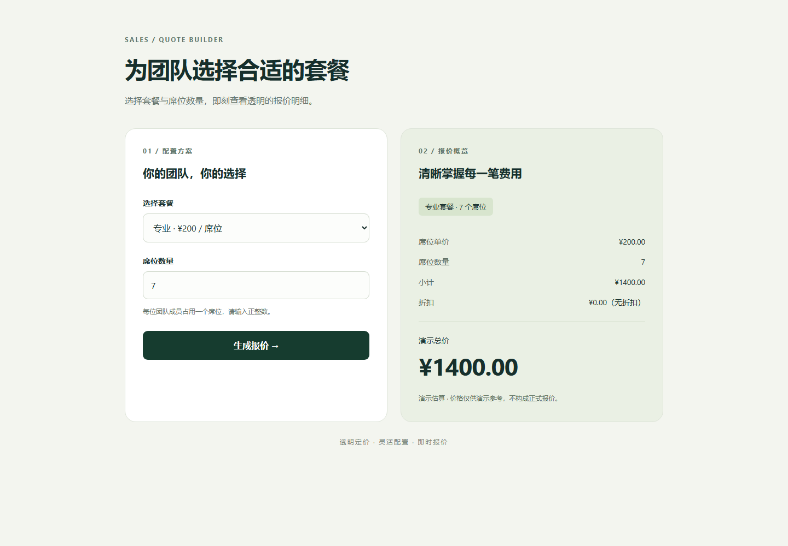

> 历史材料保留：本页记录v1阶段。当前升级请看[报价可靠性v2](../quotation-reliability-v2/结果与贡献.md)，最新结果与原实验分开统计。

# DemoPilot：从销售需求到经过验收的 Demo

**新增完整信息对照：**六题完整条件评分为原话1/6、询问整理5/6、完整规则直输5/6；功能操作检查36/68、67/68、68/68。新组所有功能检查通过，完整分数因读取检查误报保留一题未过。结果支持缺失信息获取的价值，未显示意图整理带来额外最终通过收益。最新归因以[三组报告](../quotation-information-ablation-v1/结果与简历贡献.md)为准，下面保留原两组与历史阶段记录。

**2026-10-16 最新报价专项：**整理10条有公开规则依据的需求，4条调试、6条保留测试；真实CLI生成后独立操作全部数据，完整业务通过由直接生成1/6变为先询问5/6。Core调用14对14、返工1对1；询问增加11次调用。剩余1条是操作超时，原样诊断通过但原评分不改。详情见[报价结果与贡献](../quotation-intent-v1/结果与贡献.md)及[具体案例](../quotation-intent-v1/案例说明.md)。以下保留此前阶段的成绩，不能合并分母。

**项目目的：让销售从一句不完整的需求出发，得到符合业务目的、可以现场操作的售前 Demo。**

这段经历适合突出 Agent 工作流、后端任务可靠性和评测能力。当前是本地静态演示项目，代码由本人作出目标和工程决策、结合 AI 辅助实现；没有生产客户收益或大规模服务数据。

## 你的贡献与产出

| 你的设计与改进 | 已产出的东西 | 用什么证明 |
|---|---|---|
| 把初始话术、追问、销售回答和确认目标分开 | 意图实验链路与带明确目标、数据、验收的输入 | 同一话术有无问询的对照、完整对话与独立业务验收 |
| 让 Core 能测试、返工、受控发布 | 可插拔 Harness、CLI 迭代、隐藏候选、两次真实浏览器检查 | 每轮代码、测试、截图和最终发布状态 |
| 补齐后端可靠性与可观测性 | 任务持久化、SSE 状态同步、取消恢复、子进程收尾、只读指标 API | 真实进程回归、34 项针对性验证、真实任务 HTTP 观测 |
| 建立可以追溯的改进记录 | 分层数据、失败台账、历史数字复算和实验报告 | 41 份历史运行记录核验，以及本轮新实验 |

## 已有结果怎样表述

- 基础 20 例首次通过 15 例；针对 5 个失败样本定位原因、修复并逐例复测，5/5 通过。增量合并为 20/20，不能写成修复后单批 100%。
- 8 个更长流程的案例通过了已编写的契约，其中 6 个需要返工，共 9 次。它证明这套迭代过程可以处理这些流程，不代表真实企业业务全部可用。
- 4 对 prompt 小样本比较中，两组最终均 4/4 发布，结构化目标输入的返工为 1 轮，旧输入为 5 轮；这是初步观察，与意图问询实验分开。
- 此前3对意图问询实验，直接生成业务通过1/3，问询组0/3，另有1例问询结果无法确认；该批没有证明收益，原评分保留。新报价专项在6条保留题上观察到1/6→5/6，属于不同数据、不同阶段，详见[指标与实验报告](指标与实验报告.md)。
- 在发现覆盖缺口后，明确业务要求并将三类场景验收从 5 条扩展到 24 条；新生成的 3 例已通过独立业务复验，24/24 路径通过。这是联合修复回归，原意图 A/B 成绩保留。

## 当前能力与下一层目标

Core 的真实生成、测试、修复和发布闭环已经实现。意图询问通过独立实验 runner 验证，使用冻结脚本扮演销售回答；产品页面仍采用人工填写、确认。

本次用户选择先聚焦报价，已完成10条公开规则改编需求、4/6留出和完整对照，不以旧计划20对、18/20作为已取得成绩。真人页面问答、更多产品体系与重复运行仍是后续能力；本次只能声称模拟销售条件下的小样本交付改善。

## 直接使用这些材料

| 用途 | 文件 |
|---|---|
| 明确要做什么、产出和验收 | [目标与验收](目标与验收.md) |
| 给模型继续推进的长期目标 | [GOAL_PROMPT](GOAL_PROMPT.md) |
| 讲清背景、架构和个人贡献 | [项目说明与个人贡献](项目说明与个人贡献.md) |
| 复制到简历的 3 条项目描述 | [简历项目描述](简历项目描述.md) |
| 30 秒、2 分钟介绍与常见追问 | [面试讲稿与追问](面试讲稿与追问.md) |
| 后端设计、代码位置和指标口径 | [后端设计与指标](后端设计与指标.md) |
| 核对实际成绩与改进证据 | [指标与实验报告](指标与实验报告.md) |

数字可以通过 `backend/.venv/Scripts/python.exe scripts/collect_portfolio_evidence.py` 重新计算。面试时优先讲一项机制、一例真实失败和一个清楚限定的数据结果，再按追问展开。

## 真实生成结果示例

下图是 Core 生成并实际操作后的报价页：专业套餐、7 个席位、总价 1400，小计与折扣明细可见。它是本地样例演示，不是生产报价服务。

