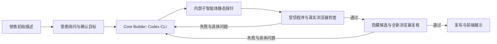

> 历史材料保留：本页记录v1阶段。当前升级请看[报价可靠性v2](../quotation-reliability-v2/结果与贡献.md)，最新结果与原实验分开统计。

# DemoPilot：项目说明与个人贡献

最新归因见[报价三组报告](../quotation-information-ablation-v1/结果与简历贡献.md)：新增完整规则直输后，业务功能检查68/68通过，固定完整评分因读取误报保持5/6；主动问询5/6、原话1/6。现有证据支持自动获得并完整传递缺失业务信息，尚未显示意图整理本身有额外最终通过收益。下面的架构与历史贡献继续适用，历史成绩不混入新分母。

## 项目解决什么问题

售前销售往往先给出一句大致需求，例如“做一个采购审批演示”。直接让模型写页面，可能产生能点击却不符合客户目的的结果：缺少审批规则、不同申请状态互相覆盖，或者模型宣布完成时功能并没有经过实际操作。

DemoPilot 的目标是缩短从销售需求到可操作 Demo 的距离。系统先询问需求中影响实现的细节，再把业务目的、预期效果、数据位置和验收方式交给 Core Builder。Core 用 Codex CLI 生成并迭代，只有通过检查的结果才能展示。

当前交付是使用本地样例数据的静态演示。它没有对接客户生产 CRM、采购平台或数据库，也没有取得真实销售转化率数据。发票场景是样例驱动的交互 Demo，不等同于研发了真实 OCR 引擎。

## 目标架构与已实现边界

FastAPI 后端管理任务、状态、事件和文件。Core 通过 `HarnessAdapter` 调用执行框架：本阶段实现 Codex CLI，后续可以实现同样的 build/acceptance 接口。Vue 负责创建任务、查看事件与结果；仓库中仍保留早期 9 节点完整流水线，它不应与当前 Core 评测主链路混讲。

意图询问目前通过独立评测 runner 真实调用 CLI，并用冻结销售脚本回答；产品表单仍采用人工填写和确认。不能把实验中的脚本销售说成已经上线的真人访谈功能。下一层产品工作是将同一意图会话接入 API 和前端回答入口，复用现有生成与验收链路。

## 个人贡献如何说明

### 1. 把模糊需求变成可检查的交付目标

本人明确了“销售一句话 → 询问细节 → 意图确认 → 生成”的产品目标，提出 prompt 必须包含 context、目标和评估方式。工程中将原始话术、模型追问、销售回答和结构化目标分别保存，并对未经追问就宣称准备完成的情况记录协议失败。

产出包括意图 prompt、冻结的销售回答脚本、意图输出校验与真实对照实验。这个贡献的效果必须通过最终业务通过率和返工次数评价，不能用结构化字段看起来更完整来代替。

### 2. 将 Core 做成可返工、可替换执行框架的模块

本人推动链路收敛为意图、Core 迭代、展示三个模块。Core 的实际执行使用 Codex CLI；每次生成后由测试反馈具体问题，在同一工作目录中修复，达到预算后仍失败就保持隐藏。可替换的是执行适配器，当前没有第二种 Harness 的真实互换实验。

产出包括 Harness 接口、Goal Prompt、独立运行目录、子智能体验收证据和返工循环。记录中的中间失败如果由 Core 自己修复并最终通过，只计为返工；最终发布后被独立审计发现的缺陷才是明确的交付失败。

### 3. 让测试证据决定能否展示

本人要求按 demo ID 固定测试数据与功能验收，不接受只演示一条数据或只看模型自报完成。子智能体执行只读静态探针，父进程再用真实 Chromium 操作页面；通过后先进入隐藏候选区，在全新浏览器环境复核后才能发布。

产出包括 20 个基础分层案例、8 个困难流程案例、功能验收文件、截图、发布状态和完整 CLI 记录。难例验证了已编写契约中的多阶段行为，尚不能代表真实企业业务复杂度。

### 4. 通过失败归因改善后端可靠性

本人提出失败台账必须说明改进前、采取的措施和改进后，并区分意图错误、Core 产物问题和执行故障。历史 5 个失败样本中，2 个属于 CLI 工作区路由，3 个属于生成产物不能同时满足功能、离线和安全规则；针对后者增加离线 fixture 常量、禁止运行时网络读和修复后重跑规则。

本轮还复现了进程已经退出但输出管道没有关闭时任务仍持续等待的问题，修复整个会话的超时范围、避免多协程同时读取同一输出流，并保留取消前的日志。新增只读指标接口从原始运行文件重新计算耗时、调用、返工和已报告 token，为后续实验提供一致的后端观测入口。

## 已核验的结果与边界

| 问题 | 方法 | 结果 | 可以说明什么 |
|---|---|---|---|
| 20 例首批有 5 个未交付 | 失败分型、定向修复、逐例复测 | 首批 15/20；补测合并为 20/20 | 有记录的失败恢复；不是同版本单次全量 100% |
| 更长流程中能否迭代 | 8 个困难案例，真实 CLI 与双浏览器门禁 | 8/8 通过已编写契约；6 例共返工 9 次 | Core 迭代在这套已知流程上可运行 |
| 更明确的 Goal Prompt 是否减少返工 | 4 对相同案例比较旧/新输入组织 | 两组均 4/4 发布；返工 5→1，调用 18→10 | 小样本观察；不是意图问询效果或无偏因果结论 |
| 数字能否追溯 | 从结果清单读取并与 run.json 对照 | 41 份历史加 9 份本轮记录，共 50/50 可读且状态无冲突 | 不同实验不拼成一个成功率；没有重跑所有旧页面 |

本轮意图询问对照的最终结果独立记录在《指标与实验报告》中，不与上面三种口径合并。

## 后端可以具体讲什么

- `RunManager` 使用 asyncio 管理长任务，提供取消、恢复和启动时状态恢复；当前是单进程本地调度，不是分布式消息队列。
- `RunStore` 将任务、事件和检查结果原子写入 JSON，并通过临时文件替换避免读到半写状态。它适合本地 MVP，没有跨进程事务能力。
- 运行记录保留事件序号供回看；SSE 按更新时间推送完整任务快照，重连可取得当前状态。当前没有按 Last-Event-ID 做服务器增量重放。
- CLI 调用使用独立目录、写入规则、受保护输入哈希和事后路径审计。该边界不等于容器级强隔离。
- `GET /api/runs/{run_id}/metrics` 是只读指标入口：缺少 token 的会话记为未知；警告不会自动被误判为最终失败。
- 候选通过两次实际检查后才写入 `published`，文件下载路由会拒绝尚未通过验收的 Demo。

## AI 辅助开发的表述

可以说：“这是一个 AI 辅助实现的个人项目。我负责产品目标、架构取舍、测试与发布规则、实验设计和失败复盘，使用 Codex 进行实现与迭代，并通过代码和真实运行证据验收。”

不建议说“所有代码由我手写”或“我训练了 Agent 模型”。面试时应能打开关键代码解释状态变化、取消路径、发布条件和实验分母，这才是可验证的工程贡献。
