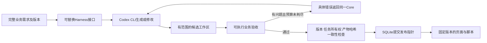

# 从生成Demo到可验收的生成流程

项目要解决的不是报价系统全部功能，而是销售需求交给代码Agent后，如何判断生成结果真的符合业务要求，并在新增需求后可靠修复。报价是一个有公开规则、可算清金额、又有审批状态的具体载体。

循环的目标、完整规则、测试文件位置、允许修改范围和验收命令都写入CLI实际收到的prompt。CLI对话和每次检查保存在模型上下文之外，失败不会被后续成功覆盖。产品内部使用确定性业务检查，不再依赖一个只读代码后表示认可的独立Reviewer。实验结束后的另一次浏览器核验用于评估整个Core的最终结果，不会把检查结果喂回模型继续改分。

## 真正可追问的三个问题

1. **模型说“完成”为什么还不够？** 页面能打开、控件存在，不能证明优惠计算正确或经理审批没有被绕过。用独立Decimal金额模型与业务状态机，把输入和动作序列编译成逐步可见结果，再通过本机Chromium实际填值、切换角色、点击和读取页面。检查器和生成JS不同实现，仍需人工核对规则及受控错误检验，不能把脚本全绿直接当成人类全面认可。
2. **新功能加好了，为什么旧功能会坏？** 新增运费会影响整单总价、审批门槛、重算和修改后审批失效。v2必须同时通过v1原有路径和新增配送路径；新功能通过与旧功能回归分别统计。这里验证的是声明路径内的行为保持，不是任意未来输入的数学证明，也未宣称浏览器已有用户数据跨代码版本迁移。
3. **两个任务交错完成，为什么不能谁先完成就发布谁？** 新需求到来后，旧任务可能晚返回。需求版本必须单调、同一版本只能一个任务持有写入所有权；验收记录绑定具体产物哈希，发布事务再次核对最新版本。文件先存成包再提交数据库指针；提交前中断可能留下未引用包，读取时继续校验哈希并拒绝损坏产物，尚未验证机器断电后的文件持久性。HTML相对资源也必须固定到同一版本，避免打开旧页面却加载新脚本。当前令牌没有到期和续租机制，属于单机任务所有权控制。

## 哪些是实际个人贡献

可以明确归到你的项目贡献：提出并落实需求澄清、完整目标与可执行验收的输入契约；把单次生成改成预算内自测返工循环；设计允许写入的工作区与失败隐藏规则；构建公开来源支撑的报价评测；用完整信息对照分离“补充信息”与“处理形式”的作用；升级业务回归门禁及版本安全发布。实现中使用Codex辅助，不应写成完全手写全部代码。

数据与效果必须以[结果与贡献](结果与贡献.md)及原始结果文件为准：100是业务组合数，对应10类应用；每版本最多3次CLI调用、每次300秒；不能写成100个真实客户或100个独立生产项目。新Core和发布台使用独立入口，旧Vue销售询问表单尚未接入这一新增模块。

## 面试时的表达

“我做的是一个把销售需求变成可交互演示的Agent系统。最初发现，页面生成成功和业务做对是两回事；而且新增功能会同时影响价格、审批和旧流程。我把业务规则变成可以直接执行的验收契约，让Codex在固定预算内生成、测试、按错误返工，通过后才发布。后端用需求版本、任务所有权和产物哈希绑定验收与发布，避免旧任务覆盖新需求，也避免页面与脚本跨版本混用。然后用完整信息、同模型预算的对照和独立浏览器核验，测量这套机制实际减少了多少错误放行与旧功能回归。”

本轮完整复验中，强基线与业务门禁组均14/14个版本通过，未观察到最终通过率增益。同一批8类受控错误中，结构检查发现0/8，业务门禁发现8/8；真实CLI内部修复与固定版本资源也有独立记录。主要贡献因此落在可执行业务验收、发布一致性及可复现性，详细数字见[结果与贡献](结果与贡献.md)。
