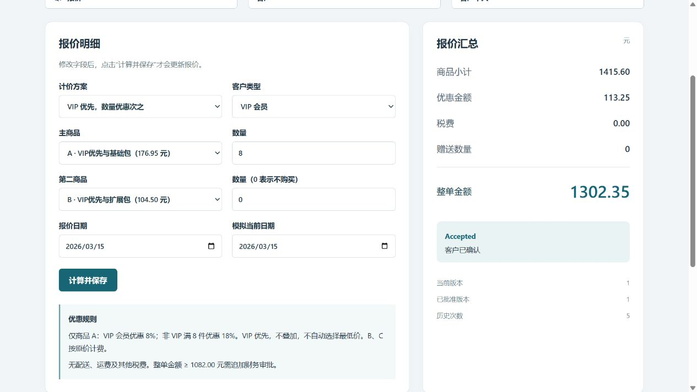

# CLI连接修复与原失败17条复测结果

原失败组 **0/17→17/17**；独立真实Chromium原计划115条，实际执行115条、通过115条；51份HTTP资源字节一致。

原首轮 **23/40（57.5%）**、原开发 **3/20及19/20** 全部保留。前23条加本次恢复17条，是累计 **40/40** 交付覆盖，不是同一版本完整重跑40条的成功率，不是意图方法的因果提升。最终100题仍执行0条。

## 故障在哪里，怎么处理

原40中15题在意图CLI调用失败，109/110在Core调用失败。不是发布后才被最终检查查出业务错误。现场代理日志可见codex.exe访问服务时出站目标不可达；CLI原轨迹又显示WebSocket握手TLS EOF后回退HTTP。代理日志在诊断时采集，没有逐请求关联，不能断言全部历史失败都只有同一个根因。

修复CLI适配器错误信息被analytics警告掩盖的问题；进程内将同一官方ChatGPT服务改走HTTPS/SSE，避免WebSocket TLS失败及等待回退；固定原项目Python并实际启动Chromium点击，拒绝缺少读写/浏览器预检的长批次。账号、模型、每次300秒、每题3次意图＋3次Core、并发2和2100秒任务上限不变，业务提示、数据、销售事实、评分源码均未改。

同一账号经修复后的CLI真实完成只读回答和指定目录文件写入；两次新探针23.58/26.77秒、未出现路由重连。原项目Playwright1.62/Chromium151实际点击成功。23项相关协议检查通过，业务执行和验收函数AST保持一致。

## 最终结果

| 指标 | 原40中同17条 | 正式修复复测 |
| --- | ---: | ---: |
| 完整交付 | 0/17 | 17/17 |
| 发布后功能缺陷 | 0（无发布） | 0（发布17题） |
| 独立浏览器路径：计划/执行/通过 | 115/6/6，含隐藏109 | 115/115/115 |
| 根CLI调用 | 24 | 49 |
| 有usage / 缺失usage | 3/21 | 49/0 |
| 已报告输入 / 输出token | 74281/1427 | 5697249/121461 |

正式复测内部返工0轮；未完成根调用0次；CLI error/turn.failed事件1条。重连后正常完成的瞬时事件不算最终失败；内部返工与最终未交付分别统计，未通过仍保持隐藏。

所有17题先结束生成，再运行新的独立Chromium评分；核对已发布HTTP三资源。未用最终评分给Builder补题，未人工改页。逐题结果见[17题记录](recovery-17/17题逐题结果.md)。若有未交付，阶段和实际检查均在该表保留，不把中间错误当最终失败。

## 额外手动浏览器检查

在本机内置浏览器操作109：8件商品按VIP8%优先规则得到1302.35元，经经理、财务和客户确认，状态为Accepted。该手动示例单独留证，不增加115条私有路径的数量。

[操作记录](browser-manual-check.json)

## 消耗与保留的执行问题

正式复测49次根CLI（意图32、Core17），49次有用量、0次缺失；已报告输入5697249（含缓存4610432），输出121461，墙钟44分45秒。

另保留一次环境配置错误的v5批次：17题均到终态、0发布，系统Python需要的浏览器缺失使最终独立验收中止；21次CLI仅4次有用量、17次缺失，墙钟22分42秒。这是本次预检遗漏，不能删掉或用成功结果替换。

额外6次真实诊断全部有用量，诊断墙钟合计5分14秒；输入182173含缓存129408，输出294。本次新增调用总计76次（诊断＋中止批次＋正式17复测）。缺失usage不记0，缓存已包含在输入内；根用量可能不含全部原生子Agent，人民币账单未知，不能声称完整总成本或已验证省钱。

## 结论边界与证据

这次测量的是已知基础设施受阻任务恢复后的交付情况。HTTP传输与运行环境共同修复，网络状态也可能变化，不能把全部提升归给某一个开关，更不能证明已永久修好代理上游。批次持续故障后的熔断/断点恢复仍未实现，没有节省效果结论。

原始对话、提示词、CLI stdout/stderr、逐轮测试和源文件快照保留在本机`.data/sales-benchmark-v3/`；公开摘要不含凭证或本地环境配置。

正式评测进程已结束。确认原销售API空闲且进程归属明确后，已加载同一修复后的连接适配器；销售页面仍可访问，原两版记录与3份固定资源保持一致。没有额外模型调用，100条最终题未动。

证据：[事前协议及修订](复测协议.md)、[机器对比与哈希](comparison.json)、[源码边界](source-boundary.json)、[脱敏网络证据](network-diagnosis.json)。
