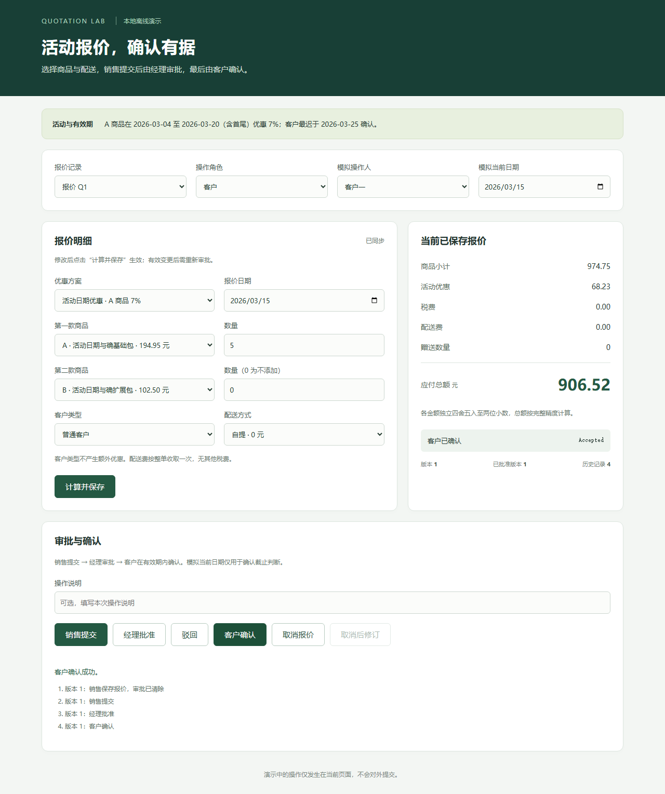

# 本轮结果与后续决定

> 2026-10-19后续完整复验已完成：原3/20→19/20（+80个百分点），119/119实际路径通过，191仍在问询。原结果保留；[最新逐题、失败和成本对比](full-rerun/结果对比.md)。

日期：2026-10-19。完成数据建设、20题真实开发摸底和3题有界修复回归，尚未进行正式三组效果比较。

## 数据完成，数量口径保持清楚

200条需求，40个作者定义的定价/流程组合场景组，每组5实例；不是200名客户，也不是40种全新审批原语。60简单、80中等、60困难，按整场景组分成60开发、40阶段验收、100最终题，变体不跨划分。

另有40异常，覆盖缺信息、冲突、超范围、非法输入、角色、运行、发布和安全。每条写明前置、动作、预期及失败定义，本轮仅构造，不声称40条已经全量实测。

各题在根目录`testdata/<ID>/`，含销售原话、销售事实、商品、规则、公开逐步验收、金额算例和中文验收文档。9份公开资料支撑规则模式；具体配置均合成，没有真实销售访谈或人工金标。1687个文件、600个另行编写的Decimal算例、17680个编译步骤的一致性检查通过，这不能替代模型与真实浏览器结果。

## 原20题：3题交付，17题停在Core之前

| 环节 | 数量 | 具体表现 |
| --- | ---: | --- |
| 确认规则不符 | 5 | 普通经理→客户被整理成专属客户或取消修订，拒绝确认错误草稿，未启动Core |
| 问询未完成 | 12 | 模型误判能力范围，或模拟销售交付公共审批语义不足，三次问询内未ready，未启动Core |
| 进入Core并最终交付 | 3 | 真实生成、公开检查后发布；发布后独立19/19路径通过，9份HTTP资源字节与验收版本一致 |

完整交付分母始终是20，结果3/20。126条计划路径中19条实际执行并通过，107条因没有产物而未运行，不能说126/126，也不能用19/19代替任务成功率。没有观察到已发布功能缺陷，但只有3题进入Core，不足以证明它普遍可靠。

这是自动模拟销售、不额外人工纠正错误草稿的严格开发校准。旧28/28专项从完整规则进入Core，新试跑从一句话开始，覆盖环节不同，不能直接比较为模型质量升降。

## 修复与实际变化

意图模块原来只给workflow枚举名称，缺少完整含义。“一个流程”被误读为一次审批，客户确认和修改重批被误判超范围。补充10个完整模板，说明共同状态和独立舍入，避免擅加专属客户、取消、过期或刷新限制。

模拟销售部分答案漏了公开接口已有的经理审批起点，已释放topic又禁止后续澄清。12道停滞题中有8题的已交付销售事实未出现经理；这可能与能力上下文问题共同作用，不能全部归为模型或Core能力差。修复只补交当前题已有公共规则，没有改业务目标、金额或标准答案。

| 选定失败开发题 | 原表现 | 修复后真实结果 |
| --- | --- | --- |
| 001，数量优惠 | 错选专属客户，未到Core | 正确单经理流程，发布后独立6/6通过 |
| 086，客户分层＋两级审批 | 声称经理→财务后不能客户确认 | 正确经理→财务→客户，发布后独立6/6通过 |
| 171，活动日期＋确认截止＋配送 | 审批人交付不足，问询停住 | 经理审批、日期和配送保留，发布后独立7/7通过 |

三例回归阶段为0/3→3/3；原20仍为3/20。后续另开完整20复验为19/20，不能替换原分数。两项接线修复共同生效，不能归结为独立prompt方法增益。没有人工修改生成页面，最终评分时产物哈希不变；6项定向协议检查通过。

上图为字节一致的已发布bundle在新本机无头Chromium的实拍。可见CUA浏览器另外观察工作台的追问、回答、构建和隐藏状态，两种证据分别保存。

## 成本记录

| 指标 | 原20题 | 3题回归 |
| --- | ---: | ---: |
| 根CLI调用 | 55 | 9 |
| 意图 / Core | 52 / 3 | 6 / 3 |
| 报告输入token | 2363188 | 959115 |
| 其中缓存，已包含于上项 | 1311360 | 751360 |
| 报告输出token | 38727 | 20640 |
| 成功任务耗时，秒 | 255.16、264.17、270.53 | 224.38、226.45、248.88 |
| 批次实际墙钟 | 1039.87秒，约17分20秒 | 500.40秒，约8分20秒 |

原20整体耗时中位数72.41秒被提前失败拉低，不能视为成功生成速度。三例不是相同成功样本的稳定耗时比较，缓存和阶段进展也不同，不声称省时省钱。CLI登录没有逐题货币账单，金额未知；原生子Agent用量不保证穷尽，token为根CLI报告。

Windows路径分隔符曾使原脚本的意图/Core分类统计为0，总调用和token正常。只读reporter按标准路径从原始JSONL重算为52/3，修正统计另存，原运行结果未覆盖；这不是模型失败。

## 原摸底后的决定及当前落实

1. 本次数据建设、20题摸底和3例回归结束，**没有继续启动剩余题、40阶段题或100最终题**。日常网页服务保留，隔离评测服务已停止。
2. 已按用户后续授权，用修复版本另开批次完整复验同20条，19/20交付；191还存在澄清应答不足，不把三例回归拼接成完整复验。
3. 根据完整复验决定是否进入40阶段验收。此前建议开发门槛至少18/20完整交付且无关键错误发布；本次19/20、0发布缺陷已达到，但40阶段题当前仍未启动。
4. 阶段验收稳定后再冻结实现，安排100最终题的原话直输、追问后生成、完整规则直输三组对照，统一模型和预算并计入问询消耗；最终题不用于调试，结果同时报告场景组及任务数。
5. 真实用户/销售反馈仍需另行安排，合成数据不能替代。

原意图能力说明和事实交接卡点在同20题复验中大幅减少，仍有191的语义澄清未闭环。当前证明的是已知开发题19/20交付，不是最终100题或真实销售可靠性；本轮没有启动其他批次。

## 检查入口

- [240条验收](../../evaluation_sets/sales-benchmark-v3/需求与验收.md)
- [原20题逐题结果](baseline/20题逐题结果.md) · [原摘要](baseline/pilot-summary.json)
- [3题回归](regression/3题逐题结果.md) · [前后证据](repair-comparison.json)
- [数据保护校验](final-data-integrity.json) · [问题与修复](问题与修复.md)

全部1687份新数据和73份历史输入SHA-256未变，100最终题未执行。原始对话、prompt、stdout、stderr、代码快照及数据库保留在本机`.data/sales-benchmark-v3/`，不上传GitHub。

交付前额外检查发现Git换行转换会破坏冻结哈希，已对新数据局部保留原字节，私有计划按原哈希恢复。在全新Git索引导出目录，1487份公开冻结文件哈希一致，200份缺失私有计划全部重建一致；原数据不改。此为可复现交付修复，不是模型效果提升。详见[新目录验证](checkout-reproducibility.json)。
