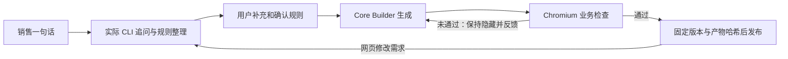
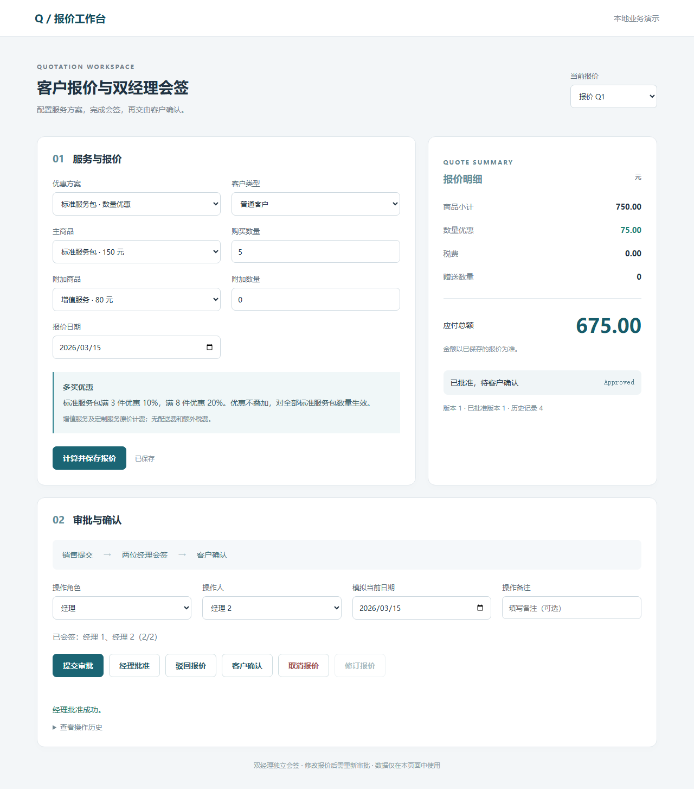

# 销售页面接入 Core Builder

日期：2026-10-18。报价网页正常链路和隔离受控返工链路均已通过真实 CLI、可见浏览器和发布后独立检查。两组分别计数。

## 用户现在怎么用

打开 [销售工作台](http://127.0.0.1:5173/)，输入一句话。实际 Codex CLI 询问缺失的商品价格、优惠规则或审批流程；用户补充后，页面列出业务规则和三个金额算例。用户勾选确认，再启动构建。

Core 每轮调用同一 Harness，实际生成页面；可信 Chromium 检查金额、审批、修改失效、错误操作和记录隔离。失败反馈给同一 Core 修复，最多三次构建调用。未通过和取消的候选保持隐藏；通过后出现打开入口。用户可以在网页修改需求、查看历史版本、取消或重试。开发者一次性启动服务后，销售无需命令行。



旧的多场景 Agent Team 控制台保留在首页折叠区。新链路当前限定报价、三款商品、一个已支持的定价规则和一个已支持的审批流程，可选配送。没有将任意需求自动变成任意类型应用的承诺。

## 遇到的问题、处理与结果

| 出问题的环节 | 具体问题 | 处理办法 | 验证结果 |
| --- | --- | --- | --- |
| 产品入口 | 销售页面和新 Core 分离，实验依赖脚本 | 新增持久化会话 API 和首页报价工作台，直接复用新 Core 的检查与发布 | 可见浏览器完成真实追问、回答、确认、生成、发布及第二次改价 |
| 需求改版交接 | 原评测把第二版固定解释为增加配送，普通改价不能照搬 | 将需求修订号与报价契约功能版本分开，目标从确认会话生成 | 需求第2版仍是无配送功能版本1；5件A从540变675，未添加运费 |
| 动态业务规则 | 参考模型默认数量优惠，档位边界来自旧题 | 采用当前契约的首个方案；从用户实际数量、日期等编译边界 | 满3/满8与满4/满10输入均使用各自规则；只含客户优惠的契约可编译 |
| CLI 输出解析 | 精简事件删除了最终正文，不能拿事件摘要解析需求 | 从本机已保留的原始 stdout JSONL 解码最终消息 | 真实追问、补充后的确认、改价重新确认均成功；回归覆盖实际事件格式 |
| 中断与重复操作 | 刷新易丢进度，重复确认可能启动多个任务 | 持久化会话、提交键去重、确认哈希、取消先撤销发布资格，恢复另开修订 | 可见浏览器在识别和构建时刷新，已保存进展保留；受控回归验证取消、重启恢复、陈旧确认和预算耗尽 |
| 版本展示 | 新需求识别时仍可能显示旧版6/6检查，使人误读 | 追问和待确认阶段隐藏旧检查，历史产物保留在独立入口 | 前端回归验证新草稿不显示旧检查；实际改价后旧链接仍为540、新链接为675 |

## 正常链路：真实浏览器做了什么

验收由助手扮演销售，使用新输入；没有真实客户访谈，没有使用固定 Provider 或手工修补生成页面。

一句话：**做一个客户报价演示，买得多可以优惠，需要两位不同经理会签后由客户确认。**

实际模型提出两个问题：三款商品名称与单价；优惠适用商品、数量门槛和折扣。销售通过网页补充：A标准服务包120元，B增值服务80元，C定制服务200元；A满3件优惠10%，满8件优惠20%，对全部A数量生效且不叠加；两位不同经理会签后客户确认，没有配送和额外税费。

页面展示1件A=120.00、5件A=540.00、10件A=960.00，用户确认后才调用 Builder。真实 Core 首次构建即通过6/6公开路径并发布。浏览器实际验证：

1. 5件A为540.00，提交后第一位经理审批仍等待会签。
2. 同一经理第二次审批被拒，历史条数不增加；第二位不同经理才能完成审批。
3. 销售修改成8件A后为768.00，状态退回Draft，原审批失效；客户此时直接接受被拒。
4. 重新提交、两位经理审批、客户确认后，状态为Accepted。
5. 在原销售页面继续修改A单价至150，其余不变。重新确认后，实际 Core 在同一应用的新工作区完成改版，5件A为675.00。
6. 第二版发布后重新打开第一版固定链接仍为540.00，第二版为675.00，没有混用新版脚本。

会话ID：`9c0bc147a5d3429c`。这是**一条新需求的两个版本**，不是两个独立客户任务。共三次真实意图调用、两次 Core 构建调用；两版均一次构建通过，没有自然触发外层返工。

## 发布后的独立检查

等每版进入最终发布状态后，另起新 Chromium 上下文检查隐藏取值与负向流程，并核对实际 HTTP 返回的HTML、脚本和样式。独立评分过程没有向 Builder 回传问题，没有修改产物。

| 项目 | 初版 | 改价版 |
| --- | --- | --- |
| 用户需求修订号 / 功能版本 | 1 / 1 | 2 / 1（没有配送） |
| Core构建调用 | 1 | 1 |
| 发布前公开路径 | 6/6 | 6/6 |
| 发布后独立路径 | 6/6 | 6/6 |
| 实际HTTP资源精确字节 | 3/3 | 3/3 |
| 额外实际HTTP页面状态操作 | 6 | 6 |
| 5件A预期 / 实际 | 540.00 / 540.00 | 675.00 / 675.00 |
| 评分时产物是否改变 | 否 | 否 |

结果摘要：[初版](evidence/revision-1.json)、[改价版](evidence/revision-2.json)。截图为独立自动化浏览器从实际发布地址截取，与可见 CUA 操作的证据分别保存。



## 返工链路：隔离受控验收

为主动覆盖正常两版没有触发的返工分支，另起隔离测试服务，沿用同一网页、API、Core及实际 Codex CLI。测试驱动在首个完整生成的候选上追加一次“计算后总价错误变为0”的故障，随后不再注入。生产入口没有这个开关，也没有向模型提供固定实现。该测试不计入自然模型失败率或准确率提升。

隔离输入：A基础服务100元、B增值服务60元、C定制服务200元；A满4件优惠15%、满10件优惠25%，全量生效不叠加；单经理审批后客户确认，没有税费与配送；5件A应为425.00。运行ID为`a117516b35694b33`。

可见浏览器实际观察：第一轮0/6，页面显示具体金额差异、候选保持隐藏，自动进入同一Core第二轮；真实CLI修复后第二轮6/6，才出现发布入口。共两次Core调用、一次外层内部返工，只发布一个修正版本。

发布后另起独立浏览器检查6/6通过，实际HTTP资源3/3字节一致；可见浏览器也实际计算5件A=425.00，经理批准、客户确认后为Accepted。整个过程没有手工修改生成页面。摘要及逐阶段时间：[受控返工证据](evidence/controlled-repair.json)；[正常网页需求与事件](evidence/visible-sales-journey.json)。

这证明网页、业务门禁、失败反馈、同Core修复与发布连通，不证明正常任务准确率提升。隔离测试服务验收后停止，不作为用户入口。

## 工程检查与历史数据保护

- 后端11项定向检查通过，包括5项新增产品接线检查及已有6项报价状态/发布检查。
- 前端7项测试、ESLint、修改路径Ruff与生产构建通过。
- 受控单元测试覆盖：未确认不构建、一次拒绝后重试、三轮失败仍隐藏、重复提交、陈旧确认、取消、重启恢复、路径约束与固定资源入口。
- 原专项20份本机独立计划验证一致；冻结输入清单73个文件均无漂移。没有重跑或替换历史100组合评分。

上述单元测试验证状态和接线，不能替代实际模型及浏览器功能验收。

## 启动与证据位置

在项目根目录复制`.env.example`为`.env`并确认本机CLI已登录；凭据无需放入项目。安装依赖后用`start.ps1`，或两个终端分别启动：

```powershell
# 终端1，项目根目录
uv run --directory backend uvicorn --env-file ../.env --app-dir src demopilot.main:app --host 127.0.0.1 --port 8091
# 终端2
npm.cmd --prefix frontend run dev -- --host 127.0.0.1 --port 5173 --strictPort
```

默认每次CLI调用300秒，每版最多三次构建调用；实际模型继承本机CLI配置，也可单独设置`DEMOPILOT_CODEX_MODEL`。报价工作台不会自动切换Mock。对话最多30条，当前单服务进程串行执行销售任务。

本机`.data/sales-core/sessions/<id>/`保留需求消息、会话状态、规则/测试输入、每轮prompt、stdout JSONL、stderr、检查和终态；`.data/sales-core/registry/`保留发布库和按哈希固定的产物。原始轨迹、数据库和环境文件不上传GitHub。

服务重启不会悄悄重启模型，未完成会话标为中断，用户可在网页恢复；旧任务不能覆盖新修订。当前为单机可信用户模式，没有生产身份鉴权、多租户或跨机器恢复保证；生成页禁止外部连接，发布仅指本机展示。原有100组合、4420次历史检查保持原口径，本次网页验收单独计数。
